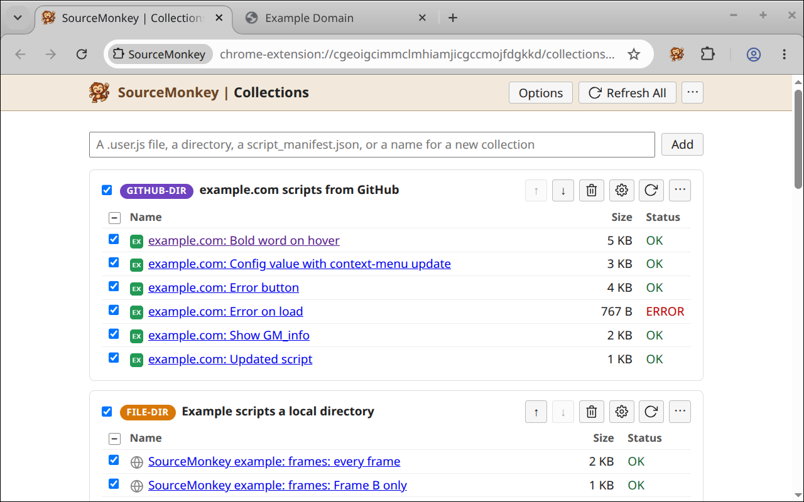
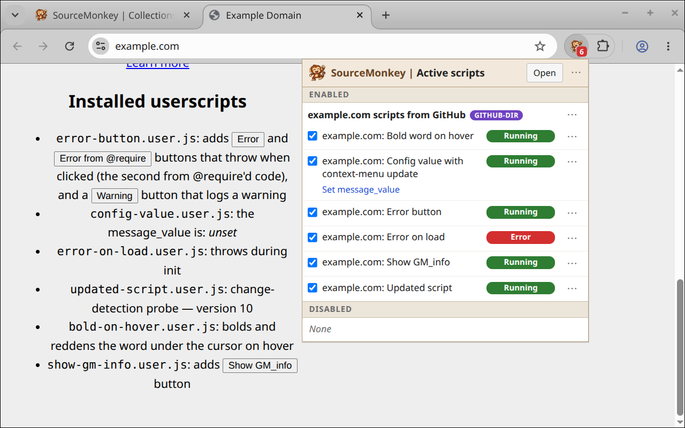

# SourceMonkey - Userscript manager Chrome extension

> [!NOTE]
> SourceMonkey is experimental and under development. There's no Chrome Web Store release yet, but you can [install the extension](#getting-started) from the released zip file, or build from source.

**Userscripts** are JavaScript patches that modify specific web
pages. They're like lightweight Chrome extensions that are easy to
write, update and share. A userscript manager stores your registered
scripts and injects them into matching web pages.

**SourceMonkey's collections page (showing loaded scripts)**



**SourceMonkey's toolbar popup (showing scripts running on a page)**



## How SourceMonkey is different

Traditional userscript managers (like [Tampermonkey](https://www.tampermonkey.net/) and [Violentmonkey](https://violentmonkey.github.io/)) are designed as script editing tools, where you view and write scripts in an editable text box in your browser.

SourceMonkey optimizes for script serving and script development as separate use cases.

In SourceMonkey, the userscript manager's main job is read-only script hosting, injecting scripts into web pages, and supporting external development.
The userscript manager inside Chrome is *not an editing or development environment*.
Scripts under development live on local disk, and are *developed using real developer tools*: a **real text editor or IDE**, **GitHub version control**, and **coding agents like Claude Code**.
Then SourceMonkey picks up local changes immediately.

SourceMonkey is optimized for those development workflows, and particularly, for **agentic userscript development**:
*Use Claude Code to easily build a userscript modifying any web page* as you like.

You can also install scripts from the web (like from [Greasy Fork](https://greasyfork.org/), or from a GitHub repo).
Here, SourceMonkey stores and serves an installed copy of the script, but isn't editing it.
The installed copy gets updated with new versions from the web source.

### Userscript development in SourceMonkey

Here's a typical setup:

* You have a local directory where you do userscript development.
  * If you're using GitHub, that's a checkout of your GitHub repo.
* You register a "Directory Collection" in SourceMonkey pointing at that directory.
  * SourceMonkey loads all userscripts (`*.user.js`) under that directory.
  * On refresh, SourceMonkey picks up any scripts added, deleted or renamed under that directory.
  * When you edit an existing script file, SourceMonkey picks up the new version immediately.
    * SourceMonkey checks for updates every time you switch to a tab, or load a page.
    * If a reload is needed to update scripts, SourceMonkey notifies you with a purple badge.
* You can do development using exactly the same script you publish.
  * You don't need to edit anything to make a "local" version.
  * Even for `@require` files: SourceMonkey can load local versions from your source directory, overriding remote URLs.

When you create a local script, you trigger a one-time SourceMonkey refresh to pick it up.
After that, you just edit the script, and SourceMonkey picks up the current code automatically.

If you commit your scripts to GitHub, then you can access them on non-development machines too.
Just register the GitHub repo as a collection, and SourceMonkey will load the current version of all scripts from that repo.

### Testing userscripts

SourceMonkey provides several tools to make testing easier and less manual.

Would you like to write unit tests for your scripts? You can.
SourceMonkey includes a client-side Playwright test fixture for testing userscripts.
It starts a real Chromium browser, with the real SourceMonkey extension, so you get the full functionality, including all `GM*` APIs.
The test can drive the web page using Playwright, and inspect or control page state and script state.

*One use case*: Write tests to detect when your script stops working because the page changed.

What about interactive testing?
SourceMonkey provides `sm-dev`, a client-side command-line tool that lets you start a browser, load scripts, load web pages, and then inspect or drive the page and the script.
You can see status and logs, read and write stored values, drive script menus, and even run JavaScript inside the script to inspect or update state.

### Agentic userscript development

**SourceMonkey and the `sm-dev` tools are optimized to work well with coding agents like Claude Code.**

SourceMonkey skills teach the coding agent how to build, test and debug userscripts using these tools.

You can start by just asking *"Build me a script to do X on site Y."*
Claude can fetch the page, figure out how it works, and write a userscript to do what you want, all working in a hidden temporary browser.
Then Claude can use `sm-dev` to try the script, on the live page.
If it doesn't work, Claude will iterate and debug until it does.

When Claude tells you it's done, just reload the page yourself in your real browser.
If it's not doing what you expected, or you want to refine further, just ask.
Claude will update your script, test it, and let you know when it's done.
Then just reload and try it again.

Simple scripts (like changing visual layout or adding buttons) are trivial to build this way, often in a single prompt.
Agentic development scales from there up to very complex stateful scripts, modifying complicated interactive web applications, media sites, or multi-page interactions.

Revising your script later uses the same process.
Just tell Claude what you want to change!

> [!TIP]
> The [SeeWhatISee](https://github.com/jshute96/SeeWhatISee) screenshot extension works great with SourceMonkey to complete the loop.
> For any page you're looking at, take a screenshot (and an HTML snapshot), highlight what you want to change, describe the change you want in the prompt, and send it to Claude Code with one click.
> Claude builds your userscript, then you reload the page and try it.

> [!TIP]
> For pages that require login or complex setup, development also works offline, directly from an HTML snapshot, building and testing a script without logging in to the live page.

## Compatibility and status

SourceMonkey works and is generally compatible with
[Tampermonkey](https://www.tampermonkey.net/) and other common
userscript managers.

Most common `GM*` APIs work, and most common script headers are supported.
See [docs/supported-GM-APIs.md](docs/supported-GM-APIs.md) and
[docs/supported-headers.md](docs/supported-headers.md) for details.

SourceMonkey isn't in the Chrome Web Store yet.
[Install it](#getting-started) from a release zip or build it from source.
SourceMonkey requires **Chrome 152 or newer**.

The [example scripts](#example-userscripts) also run as tests against
Tampermonkey and Violentmonkey.
[docs/cross-manager-test-results.md](docs/cross-manager-test-results.md)
has the latest results, and the places where the managers behave
differently.

## Example userscripts

[`tests/examples`](tests/examples/README.md) includes example scripts
that interactively demonstrate supported `GM` APIs and other
functionality.

To try them:

1. Add the examples as a collection: on the collections page, add
   `https://github.com/jshute96/SourceMonkey/tree/main/tests/examples`.
   - A new install adds this collection on its first run.
2. Open the [examples index page](https://jshute96.github.io/SourceMonkey/tests/examples/index.html).
   Each example's page runs its scripts and shows what they did.

Or open them in a fresh browser with [`sm-dev`](#starting-test-browsers-and-running-scripts-with-sm-dev):

```sh
npx sm-dev start https://jshute96.github.io/SourceMonkey/tests/examples/script_manifest.json \
  https://jshute96.github.io/SourceMonkey/tests/examples/index.html
```

These also function as the beginnings of a **compliance test suite** for userscript managers, with tests (`*.spec.ts` files in the same directory) that compare behavior across SourceMonkey, Tampermonkey, and Violentmonkey.

The [jshute96/userscripts](https://github.com/jshute96/userscripts) GitHub repo is an example of a repo with many scripts built using SourceMonkey and Claude Code.

> [!NOTE]
> **TODO**: That repo has some additional scripts and skills for userscript development.
> Extracting those as a template for other userscript repos is pending.

## Getting started

> [!NOTE]
> A Chrome Web Store release is coming.

1. Install the extension with **Load unpacked**:
   1. Get the code:
       - **From a release zip:** Download `SourceMonkey-vX.Y.Z.zip` from the
        [Releases page](https://github.com/jshute96/SourceMonkey/releases)
        and unzip it.
       - **From source:** Check out this repo and build it (see [SourceMonkey Development](#sourcemonkey-development)) into `dist/`.

   2. In Chrome, open `chrome://extensions`, enable **Developer mode**,
      click **Load unpacked**, and select that directory.

2. On `chrome://extensions`, for SourceMonkey enable:
   - **Pin to toolbar**, so the SourceMonkey icon is visible.
   - **"Allow User Scripts"**. Without it Chrome can't inject scripts.
   - **"Allow access to file URLs"**, if you want to load scripts from
     local disk.

3. Double-click the SourceMonkey toolbar icon to open the **collections page**.
   - On the first run, it adds a default collection of examples so the page isn't empty.  You can remove that if you want.
   - Use the **Add** box to add scripts or collections, from URLs or file paths. Adding a directory creates a collection with all scripts under that directory.
   - Opening userscripts (`*.user.js` URLs) in Chrome will redirect to SourceMonkey's script install page.  (You can disable this on the Options page.)

## Using SourceMonkey

> [!NOTE]
> **TODO**: The rest of these docs need updates and cleanup.

### The collections page

The collections page is where scripts are registered and managed.

- Each collection has a section listing its scripts, with:
  - enable toggles, per collection and per script
  - buttons to refresh, remove, or reorder the collection, and access additional options.
- **Refresh All**, in the header bar at the top of the page, updates everything.

Each script row shows a status, linking to that script's log, where there
are usually more details:

| Status | Meaning |
| --- | --- |
| `OK` | Loaded and registered |
| `INVALID` | The script can't run: bad or missing headers, a `@require` that wouldn't load, or a syntax error |
| `REJECTED` | The script is fine, but Chrome refused to register it |
| `REFRESH FAILED` | Still running its last good copy, but the newest update attempt failed |
| `OUTDATED` | Running and current with its own source, but the script's `@updateURL` / `@downloadURL` advertises a newer version |
| `ERROR` / `WARNING` | Loaded fine, but this script has produced errors or warnings this session |

Local scripts that have been deleted or edited since last read show a `DELETED` or `MODIFIED` chip.
Local collections with changes on disk show `REFRESH PENDING`.

Clicking a script name opens the **script viewer**, which shows the script's
headers, content (including the `@require` files it loads), status, and a
**Log** tab showing errors and other log messages.

A script that lives in a scripts collection can be moved to another one
from the viewer's **Collection** row, keeping its log and its stored
`GM_setValue` data.

**Local copy…** on the same row writes an editable copy of any installed
script into `SourceMonkey/` under the browser's Downloads folder, which
becomes the **Scripts copied in Downloads** collection. The copy takes
over as the running version, and edits made to it in any editor are
picked up by Refresh. The dialog lets you rename the file, adjust the
version (`-local` by default) and description, and optionally copy the
script's `@require` / `@resource` files beside it.

The badged trash can beside it (a can with a small disk, the glyph
reserved for deleting a file rather than just a record) deletes such a
copy: the file on disk and its record in SourceMonkey, after a
confirmation naming the path and every dependency file the copy loads,
saying which of them go with it. Copies are the one thing SourceMonkey
can delete from disk, since the browser downloaded them.

The **⋯** menus, in the header and on each collection, export all
collections or one collection to a zip file: a backup, or a way to move scripts to
another machine. Tampermonkey and Violentmonkey can import it too. See
[docs/export.md](docs/export.md).

The same menus import scripts from a backup file: SourceMonkey's own
export, or Tampermonkey's or Violentmonkey's. A preview lists the file's
scripts against the ones already installed, and offers what to do with
new ones and with ones already here, and whether to bring their stored
values. See [docs/import.md](docs/import.md).

When the same script is installed more than once (the same URL under two
collections, or the same `@name` and `@namespace` from two different places), the
viewer lists the copies in an **Other versions** panel at the top of the page,
where each one can be enabled, updated, opened, or removed. Clicking another
copy's row switches the page to it in place, leaving the panel as it is. Enabling one
copy disables the others, since two enabled copies of a script both run.
Ctrl-click a checkbox (cmd-click on a Mac) to override that. The same rule holds
everywhere a script or collection is turned on, including the collections page,
the toolbar popup, and adding a collection; turning a collection back off restores
the copies it displaced. The panel's
**Compare** column shows whether each copy's code matches the one on screen,
and a **DIFF** button opens a **compare page** showing the two copies'
header fields side by side and a diff of each file.

The **Options** link at the top, beside Refresh All, covers `.user.js` link capture,
debug logging, local file override directories, the Downloads folder
local copies land in, and a GitHub token (for private repos and a
higher API rate limit).

Details: [docs/storage.md](docs/storage.md) (status model),
[docs/script-viewer.md](docs/script-viewer.md),
[docs/script-identity.md](docs/script-identity.md),
[docs/script-enablement.md](docs/script-enablement.md),
[docs/compare.md](docs/compare.md),
[docs/local-copy.md](docs/local-copy.md),
[docs/local-delete.md](docs/local-delete.md),
[docs/script-log.md](docs/script-log.md),
[docs/diagnostics.md](docs/diagnostics.md).

### Registering collections

Type a path or URL into the Add field and click **Add**. The path can be:

- An **absolute path or `file://` URL to a directory** of userscripts.
  Scanned recursively; every `*.user.js` becomes a row.
- A **single `.user.js`**, by local path or `http(s)://` URL. This
  opens a preview in a new tab first (see below).
- A **manifest** (`script_manifest.json`): a list of userscripts to
  load. See [Manifest files](#manifest-files-script_manifestjson).
- A **GitHub URL**, pasted straight from the browser. A repo, a
  `/tree/…` directory, or a `/blob/…` file all work; directories are
  scanned via the GitHub API.
- A **name**, or nothing at all, to make an empty collection for
  scripts you install one at a time.

A directory, manifest, or name opens a small dialog first, where you can
give the collection a name and set its options; it checks that the
location can be read before creating anything.

Single scripts go into **scripts collections**: folders you create
and name, or the defaults created on demand (`Scripts from local disk`,
`Scripts from web`, `Scripts from GitHub`). One scripts collection can
mix local, web, and GitHub scripts. An `sm-dev test collection`
holds the scripts an `sm-dev` run pushed, whose only copy
is in SourceMonkey itself; it goes when the run ends (see
[docs/harness-guide.md](docs/harness-guide.md)).

Details: [docs/file-access.md](docs/file-access.md),
[docs/http-collections.md](docs/http-collections.md).

### Installing scripts from a `.user.js` link

Click a `.user.js` raw file link anywhere (Greasy Fork, GitHub, a file on your
own disk, etc.) and SourceMonkey previews it instead of letting Chrome show
the bare source.

The preview shows the script's source code and some summary information,
and validates the script and its `@require` libraries, reporting errors for
invalid scripts. Pick which collection to put it in (or make a new
one), and **Install** loads the script, the same as adding its URL on
the collections page.

If the script is already registered, the preview lists every copy and
lets you open or update each one, or install another copy elsewhere.
A script that arrives via a collection you already subscribe to can
still be installed as a copy of your own.

Link capture can be turned off on the Options page if you want Chrome's
defaults or have another userscript manager handling links.

Details: [docs/install-capture.md](docs/install-capture.md),
[docs/parse-check.md](docs/parse-check.md).

### Local development vs deployed scripts

Scripts can reference and load other files with `@require`, `@resource` and `@icon` headers.
Tampermonkey and Greasemonkey require absolute paths.

To make local development on disk easier, SourceMonkey also allows relative
paths, resolved against the script's own location. A script loaded over
http(s) may point anywhere it could already name with an absolute URL
(`../lib/util.js`, `//cdn.example.com/util.js`), matching Violentmonkey;
a script loaded from disk is confined to its own directory.
Tampermonkey resolves neither, so relative paths still cost portability.

Therefore, when publishing a script, absolute http paths are preferred.

SourceMonkey enables local development on these scripts by **reading local files
in place of http references**. For scripts run from local files, if there's
a file under the script's directory, or under the directory of the collection
it came from, matching any suffix of the requested host and path, the local
file will be read instead. So a shared `lib/` at the top of a scripts
directory is reachable from a script nested inside it.

Additional local directories can be added to the search path on the Options page.

This allows local development of the script and its resource files, without
adjusting the file paths.

See [docs/local-file-overrides.md](docs/local-file-overrides.md).

### Manifest files (`script_manifest.json`)

SourceMonkey allows adding a directory as a collection, and then
automatically loading all userscripts under that directory.

For local directories, and supported web hosts like GitHub,
SourceMonkey can list files to find the userscripts. Other file hosting
sites may not support listing files. Manifest files allow loading
multi-userscript collections from these sites too.

A manifest file is a JSON file containing a list of userscripts to
load, typically using relative paths starting from the manifest file's
location.

The manifest body is JSON in one of two shapes: a bare array, or an
object with a `scripts` key. Each entry is a URL string, or an object
with a `path` field holding that string; other fields are ignored:

```json
["foo.user.js", "sub/bar.user.js", "https://elsewhere/baz.user.js"]
```

```json
{ "scripts": ["foo.user.js", "sub/bar.user.js"] }
```

```json
{
  "scripts": [
    { "path": "foo.user.js", "note": "my fork of upstream" },
    { "path": "sub/bar.user.js", "note": "another script" }
  ]
}
```

Entry paths resolve like this:

- **Relative** entries resolve against the manifest's own location, so
  the same manifest works unchanged whether it's served over HTTP or
  read from a local directory.
- **Absolute** URLs (`https://…`, `file:///…`) are used verbatim, and
  can point anywhere.

To generate a manifest from a directory of userscripts, run
`scripts/make_manifest.sh` inside that directory and redirect stdout to
`script_manifest.json`.

### Keeping scripts up to date

Nothing polls on a timer. A script's source is re-checked at these
moments, and any change is loaded immediately: the toolbar badge then
turns purple, and its tooltip says a reload is needed.

- **Loading a page** re-checks the scripts that run on it.
- **Switching to a tab** re-checks the scripts on it that came from
  local disk. So editing a script in your editor and switching back to
  the browser turns the badge purple before you reload, and that reload
  runs the new version. Scripts installed from the web are left alone
  here, to avoid a request to their site every time you change tabs.
- **Reloading a tab picks up edits on the same click**: SourceMonkey
  races a quick re-check against the page load, so a script you just
  saved usually runs on that very reload.
- The same script is re-checked at most once every 10 seconds, so two
  edits in quick succession may need a moment before the second is
  noticed.
- **Refresh** (per collection, or **Refresh All**) checks for updates manually.
  External tools can trigger a refresh by opening the collections page with
  one of these, where `<id>` is the extension's ID:
  - `chrome-extension://<id>/collections.html?refresh`: every collection.
  - `chrome-extension://<id>/collections.html?refresh_local`: only the
    collections that live on local disk, skipping the web ones.
  - `chrome-extension://<id>/collections.html?refresh_file=<path>`: only
    what covers that file or directory, including the collections that
    scan it, so a file you added, renamed, or deleted is noticed too.
- Re-fetches are cheap: HTTP collections use conditional GETs, local files
  compare size + mtime, and unchanged content is detected by hash.
- Every script updates from the place you installed it. A declared
  `@updateURL` / `@downloadURL` is read for its `@version` and reported
  as `OUTDATED`, but never fetched from, so a script can't quietly
  move its own update channel to a site you didn't approve.

Details: [docs/updates.md](docs/updates.md).

### The toolbar icon

As you browse, the toolbar icon shows the count of how many scripts match the
current page, colored by health:

| Color | Meaning |
| --- | --- |
| **Green** | All scripts are running. |
| **Orange** | Scripts are missing, unexpected, or still loading. |
| **Purple** | A reload is needed to pick up scripts that were updated, enabled or disabled. |
| **Red** | A script had an error, Chrome refused to register it, or user scripts are disabled in Chrome. |
| **Grey** | No scripts ran, on purpose (*Reload page with no userscripts* on the context menu). |

Hovering the icon shows a more detailed summary.

Clicking the icon opens the **Active scripts** popup: the scripts that
match the page, grouped by collection, with their status. From there
you can:

- Turn scripts and collections on or off.
- Run a script's menu commands (`GM_registerMenuCommand`).
- Run a manual script (`@run-at context-menu`), which runs only when asked.
- Click a script to open the script page. Click the status badge to jump directly to its log page.
- Reload the page with no userscripts, with only one script, or
  with one script excluded. This allows testing scripts in isolation, when multiple scripts target the same page.

Double-clicking the icon opens the collections page.

Details: [docs/status-popup.md](docs/status-popup.md).

### Supported `GM_*` / `GM.*` APIs and headers

SourceMonkey supports the standard header fields and `GM` APIs common to
other userscript managers.

A script gets the APIs it asks for with `@grant`, in either the classic
`GM_setValue` spelling or the newer `GM.setValue` one. Anything it
didn't ask for isn't there. `@require`d libraries see the same APIs
their script does.

For exactly which names work and how they compare to Tampermonkey,
Violentmonkey, and Greasemonkey 4, see
[docs/supported-GM-APIs.md](docs/supported-GM-APIs.md).

For the header tags SourceMonkey honors, see
[docs/supported-headers.md](docs/supported-headers.md).

### How scripts run

Like in Tampermonkey and Violentmonkey, scripts run in the page's own
JavaScript world, so they can read its globals by name.
Unless it has `@grant none`, a script gets its own `window` showing the
browser's built-ins, so what it writes there (or a library it loads)
stays its own; `unsafeWindow` is the page's. Set `@inject-into content` or
`@sandbox DOM` to run a script in an isolated world instead.

Whatever a script throws is caught and reported against that script,
including failures that happen later, from timers, event listeners, and
promises. They show up in the script's **Log** tab with a clickable
stack trace that lands on the offending line, in the `@require`d
library file when that's where it came from.

Details: [docs/injection.md](docs/injection.md),
[docs/injection-modes.md](docs/injection-modes.md).

### Testing your userscripts

Userscripts are hard to test. The hard part is not the script, it is
the manager around it: `@match`, `@grant`, `@require` loading, and the
`GM_*` APIs. A test harness normally fakes all of that, and a fake is
the one thing that cannot tell you your script works.

SourceMonkey ships a harness that uses its own code instead. A repo of
userscripts installs SourceMonkey as a package and gets two things:

- **A Playwright fixture.** A script under test is checked by the
  extension's own install pipeline and run in the real SourceMonkey
  extension, in a browser the fixture launches. A test drives what the
  script did through the manager: read what it stored, fire a menu
  command, answer a network request.
- **`sm-dev`, a command-line tool.** Run a script in SourceMonkey
  against a live page and watch what it does, re-pushing as you save.
  Check which selectors still resolve after a site changes. Save a page
  so a test can replay it without logging in. It also fetches and loads
  Tampermonkey or Violentmonkey, to run and manage scripts under them.

Both come from npm. Use `pnpm add -D sourcemonkey` in a repo of
userscripts, or `npx sm-dev` to run `sm-dev` without installing it.
See [docs/harness-guide.md](docs/harness-guide.md) to use it, and
[docs/harness-design.md](docs/harness-design.md) for how it works.

For coding agents, [skills/SourceMonkey-dev](skills/SourceMonkey-dev/SKILL.md)
is a skill with recipes for developing and testing with these tools.
[skills/SourceMonkey-friction](skills/SourceMonkey-friction/SKILL.md)
is optional: it has agents record a friction log of problems hit using
these tools, as feedback for improving them later. Both ship in the
package, so a userscript repo can link them in:

```sh
mkdir -p .claude/skills
ln -s ../../node_modules/sourcemonkey/skills/SourceMonkey-dev .claude/skills/
ln -s ../../node_modules/sourcemonkey/skills/SourceMonkey-friction .claude/skills/
```

### Starting test browsers and running scripts with `sm-dev`

`sm-dev` starts a browser with a userscript manager loaded. Use
`--manager sm`, `tm` or `vm` to select SourceMonkey (the default),
Tampermonkey or Violentmonkey.

```sh
# Start a fresh browser with SourceMonkey, in a new profile, closed when the run ends.
npx sm-dev start

# Start a visible browser and leave it running, without an interactive sm-dev prompt.
npx sm-dev --headed start my-scripts/ --detach
npx sm-dev status  # Send it commands (like status)
npx sm-dev stop    # Stop it

# Start with a script loaded, and open the page its @match names, or the one given.
npx sm-dev start my-script.user.js
npx sm-dev start my-script.user.js https://example.com/

# Start all the scripts in a directory. (A tab opens on the first one's default page, if its @match names one.)
npx sm-dev start my-scripts/

# Start the scripts listed in a manifest file (at a path or URL), or one script from a URL.
npx sm-dev start https://example.com/scripts/script_manifest.json https://example.com/
npx sm-dev start https://example.com/scripts/my-script.user.js

# Start a browser with Tampermonkey or Violentmonkey instead.
npx sm-dev --manager tm start my-script.user.js
npx sm-dev --manager vm start my-script.user.js

# Start a browser on port 9300, with a persistent profile that's kept between launches.
npx sm-dev --browser 9300 --open-browser
npx sm-dev --browser 9300 --existing-browser manager install  # once: add SourceMonkey
npx sm-dev --browser 9300 --existing-browser start my-script.user.js

# Start with Tampermonkey, using a profile directory of your own.
npx sm-dev --browser 9301 --open-browser --profile ~/my-browser-profile
npx sm-dev --browser 9301 --existing-browser --manager tm manager install
npx sm-dev --browser 9301 --existing-browser --manager tm start my-script.user.js
```

- At a terminal, `start` opens the browser's window and a `> ` prompt
  for more commands. `exit` (or Ctrl-D) ends the run, and closes the
  browser if `start` launched it.
- A browser started with `--open-browser` stays open after `sm-dev`
  ends. Its profile is
  `~/.config/sm-dev/browser-profile-<port>` unless `--profile` selects
  a profile dir explicitly.
- `npx sm-dev` alone opens an interactive prompt to type commands at.
- Use `npx sm-dev help`, and see
  [docs/harness-guide.md](docs/harness-guide.md), for more commands and
  details.

### Validate userscripts from the command line

`sm-dev validate` runs the install-time checks (header validation,
`@require` / `@resource` loading, and the compile-only syntax check)
over files on disk, with no browser involved:

```sh
npx sm-dev validate path/to/scripts/    # a directory, or single files
```

It reports each script as `ok` or `invalid` with the same message the
extension would show, plus any warnings.

### Greasy Fork test corpus

The Greasy Fork corpus (`tests/greasyfork-examples/`) has test results from a
sample of real-world userscripts: the 2000 most-installed scripts on Greasy
Fork, plus others added since.

- **Validation:** every script was checked with SourceMonkey's install-time
  checks (the same ones `sm-dev validate` runs).
- **Live testing:** where possible, Claude ran each valid script on its
  target site with `sm-dev`, judged whether it does what it promises, and
  recorded whether a failure is the script's or SourceMonkey's.

Results:

- [Test results](https://jshute96.github.io/SourceMonkey/tests/greasyfork-examples/results.html):
  a sortable, filterable table of every script's validation and test
  status, with notes.
- [Analysis](https://jshute96.github.io/SourceMonkey/tests/greasyfork-examples/analysis.html):
  statistics on which headers and `GM_*` APIs the scripts use most.
- [SourceMonkey test status on Greasy Fork](https://jshute96.github.io/SourceMonkey/tests/greasyfork-examples/show-on-GreasyFork.user.js):
  a userscript that shows test results inline on Greasy Fork, next to the
  stats on script pages and search pages. Open the link with a userscript
  manager to install it.

More detail:

- [tests/greasyfork-examples/README.md](tests/greasyfork-examples/README.md):
  the tools, the record format and what each test status means.
- [docs/corpus-validation.md](docs/corpus-validation.md): the bulk validator,
  and [docs/corpus-validation-results.md](docs/corpus-validation-results.md)
  for its last run's findings.

## SourceMonkey Development

### Setup

Node.js 22 or newer is required.

This repo uses the [pnpm](https://pnpm.io) package manager. Install it:

```sh
npm install -g corepack   # only on Node 25+, which no longer includes Corepack
corepack enable pnpm
```

Then install the dependencies and Playwright's Chromium:

```sh
pnpm install
pnpm exec playwright install chromium
```

### Build

```sh
pnpm run build       # build into dist/
pnpm run watch       # automatically rebuild when TypeScript files change
```

The built extension is written to `dist/`. Install as described in
[Getting started](#getting-started).

The build also generates `sm-dev` and the test harness code in `lib/`.
([Details here](docs/architecture.md#two-outputs-dist-and-lib).)
`scripts/sm-dev` runs the `sm-dev` built here.

```sh
# Example: Run the sm-dev built here.
scripts/sm-dev --help
scripts/sm-dev validate tests/examples
```

### Test

```sh
pnpm test              # unit + e2e + sm-dev
pnpm run test:unit     # node --test, fast
pnpm run test:e2e      # Playwright with the extension loaded
pnpm run test:headed   # e2e with a visible browser
pnpm run test:sm-dev   # sm-dev and the harness fixture's own specs
pnpm run test:vm-api   # whether the fetched Violentmonkey still answers sm-dev's calls
pnpm run test:tm-api   # whether the fetched Tampermonkey still answers sm-dev's calls
```

To narrow a run to one file:

```sh
node --test tests/unit/header-parser.test.mjs    # For one unit test (run `pnpm run build` first)
pnpm run test:e2e tests/e2e/injection.spec.ts    # For one e2e test
```

The examples suite (`tests/examples/`) can also run against
Tampermonkey or Violentmonkey for cross-manager compliance checks.
Each run starts a new browser with the manager loaded, so there's
nothing to set up:

```sh
pnpm run test:e2e:tm          # headless
pnpm run test:e2e:vm
pnpm run test:e2e:tm:headed   # with the browser window shown
pnpm run test:e2e:vm:headed
```

The manager is the copy `sm-dev` downloads from the Chrome Web Store,
fetched on the first run. `scripts/sm-dev --manager tm manager fetch`
(or `vm`) updates it.

See [docs/testing.md](docs/testing.md) for the harness layout,
[docs/cross-manager-testing.md](docs/cross-manager-testing.md) for how
the manager runs work, and
[docs/cross-manager-test-results.md](docs/cross-manager-test-results.md)
for known per-manager divergences.

### Code layout

- `src/`: source (TypeScript + manifest + HTML). See
  [Source layout](docs/architecture.md#source-layout).
  - `src/extension/`: modules only the extension loads.
  - `src/harness/`: the development harness (`sm-dev`).
  - `src/`: code shared by both.
- `scripts/`: build, test and release scripts.
- `tests/`: tests and test data. See [docs/testing.md](docs/testing.md).
  - `tests/unit/`: unit tests.
  - `tests/e2e/`: Playwright tests that load the unpacked extension.
  - `tests/examples/`: interactive userscript example pages with paired
    userscripts; double as a cross-manager compliance test. See
    [tests/examples/README.md](tests/examples/README.md).
  - `tests/bad-examples/`: example userscripts with errors.
  - `tests/greasyfork-examples/`: [results](https://jshute96.github.io/SourceMonkey/tests/greasyfork-examples/results.html) and
    [analysis](https://jshute96.github.io/SourceMonkey/tests/greasyfork-examples/analysis.html) from testing SourceMonkey on a selection
    of top scripts from Greasy Fork.
- `docs/`: design docs. Start with
  [docs/architecture.md](docs/architecture.md) for the component map,
  and [docs/file-index.md](docs/file-index.md) for a one-line
  description of every file.
- `packages/sm-dev/`: the `sm-dev` npm package, which runs
  `sourcemonkey`'s CLI so `npx sm-dev` works.
- `packages/sourcemonkey`: the `sourcemonkey` npm page.

## Privacy

SourceMonkey collects no data. See the [privacy policy](PRIVACY.md).

## License

MIT. See `LICENSE`.
