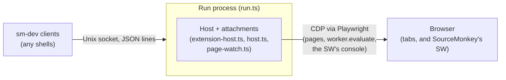

# sm-dev: design

`sm-dev` is the harness's interactive command-line tool. It builds on
the harness core described in [harness-design.md](harness-design.md);
the commands themselves are in [harness-guide.md](harness-guide.md).

## Overview

- A **run** is a background process that owns one browser connection,
  its tabs, and the loaded scripts. It never reads stdin.
- The `sm-dev` process is only ever a **client** of runs: it starts
  them, sends them commands over a local socket, and prints what comes
  back. Any number of clients can talk to one run.
- The run connects with Playwright's `connectOverCDP`, or launches a
  Chromium itself with `--temp-browser`.
- A run pushes its scripts into SourceMonkey in its browser, which
  needs it installed: it claims its tabs, and fills its host from the
  extension's events. See
  [Running scripts in SourceMonkey](#running-scripts-in-sourcemonkey).

### Processes and connections

- The host hears what the scripts do from the SW's event stream (see
  [The event stream](#the-event-stream)); pages add nothing of sm-dev's
  that they can see.

### Modules

| Module | Role |
| --- | --- |
| `cli.ts` | The client: global options, sm-dev's own commands, the `Client` connection, starting runs |
| `run.ts` | The run process. Its own module so the Node-only commands never load Playwright |
| `runs.ts` | The registry of runs on this machine, and the client connection (`RunClient`). Node-only |
| `run-log.ts` | Each run's log file |
| `command-list.ts` | Every command's help, arguments and options, as data |
| `command-lines.ts` | Input lines into commands: blocks, lists, stdin |
| `checks.ts`, `path-args.ts` | `match` / `validate`, and file-argument globs |
| `console-commands.ts` | A run's commands across its tabs, the dialog tracker, the `--interactive` prompt |
| `prompt-history.ts` | The prompt's history file, kept across sessions |
| `prompt-editor.ts` | Multi-line editing of `{{` blocks at the prompt |
| `page-commands.ts`, `snapshot.ts` | Commands that drive and read a page |
| `wait.ts` | `wait`, and when a tab has settled |
| `tab-refs.ts` | Naming and picking tabs (`T2`, target ids), the current tab, the dialog message |
| `save-html.ts`, `saved-pages.ts` | Saving a page, and serving it back at its URL |
| `browser-launch.ts` | `--open-browser` |
| `browser-lang.ts` | `start --lang`: the languages the run's tabs prefer |
| `stuck-tabs.ts` | Waiting out unresponsive tabs before connecting |
| `page-output.ts` | Which page console lines and errors the run streams |
| `host.ts` | The records host: the scripts' reports, a copy of their values, menus, and the waits on them |
| `extension-host.ts` | `ExtensionHost`: fills the records host from the extension's events, and answers commands from it |
| `page-watch.ts` | Watch-only attachments: a tab's documents, activity for `wait`, and `eval` |
| `extension-link.ts` | `ExtensionLink`: the calls into SourceMonkey's SW, tab claims, and its event stream |
| `extension-backend.ts` | SourceMonkey's extension id, and finding its SW |
| `extension-launch.ts` | `--temp-browser`: Chromium with SourceMonkey (or `--manager`'s manager) loaded |
| `managers.ts` | The managers `--manager` names |
| `browser-extensions.ts` | The managers in a browser, and turning them on, off and in |
| `manager-fetch.ts`, `manager-actions.ts` | `manager fetch` from the Web Store; the `manager` verbs |

## Runs and clients

### Starting a run

- `start` (in `cli.ts`) runs the same `start` command again as a
  detached child process, and waits for the child to be ready.
  - The child's stdout and stderr go to its log file. The parent prints
    the file as it grows, without the line timestamps, until the child
    is ready.
  - The child learns it is the run from `SM_DEV_DETACHED_LOG`.
  - It says it is ready over the Node IPC channel (`onReady`, called
    where sent commands start being taken). A child that exits first
    passes on its exit code.
  - A child whose parent has gone (a tool timeout) still becomes ready;
    with no channel to report on, it just runs on.
  - The parent handles Ctrl-C, SIGTERM and SIGHUP (sent when the
    terminal closes) while the child starts, by ending the child and
    exiting 130.
- The run's own process gets the browser's options again, as global
  options, on its command line.
- What a new run replaces is stopped before it starts, so its tab is
  free to reuse. (A new run that then fails leaves neither.)
  - The run the client works with, whose id the new one takes.
  - Else, with `--detach` and not `--new`, runs whose record is marked
    `detached`.

### The run registry (`runs.ts`)

Serves `sm-dev list`, `stop`, `attach` and the commands sent to a run.

#### Ids

- A run's id is the lowest free `D<n>`. It takes one by listening on
  its socket, which only one process can. The record is written after,
  so `list` never shows a run it can't reach yet.
- A socket file nothing listens on (a killed run's) is cleared and
  listened on under a `D<n>.clearing` lock directory, held until the
  listen. Otherwise a second run could delete the first's freshly bound
  socket.
- A lock already held means trying the next number, so one left by a
  killed run costs a number, never a hang.
- `--run Dname start` takes that id the same way, or fails if a run
  holds it; `cli.ts` stops that run first.

#### Records and sockets

- A run waiting for commands writes a record file (id, pid, start time,
  browser and whether it's owned or headless, scripts).
- It listens on a Unix socket (a named pipe on Windows).
- Both live in a per-user temp directory, `sm-dev-runs-<user>` (by user
  name, or uid where there is none). `SM_DEV_RUNS_DIR` moves it, for
  tests.
- Stale records:
  - A record is deleted when listed if its pid is gone, or its socket
    refuses connections (the pid may have been reused).
  - The run deletes its own on the way out.
  - The delete re-checks first, since a new run may have taken the id:
    the record only if it names the same pid, the socket only if
    nothing listens on it.
- Permissions: the directory is created `0700`. Before anything in it
  is trusted (records, sockets, tab records), it is refused if another
  user owns it or can write in it, since `stop` signals the pids its
  records name.

### The client (`Client` in `cli.ts`)

- Holds the connection to the one run it works with: `--run`'s, else
  the one it started or attached to, else the only one. Made when a
  command first needs it.
- `start` and `attach` switch it to another run; `stop` leaves it with
  none.
- `status` with no run shows the browser the line would use
  (`--browser`'s) and its managers, then every run's status, headed
  `Other run:`.
  - Under `--json`, `browser` and a `runs` layer holding each run's
    status, even with only one going. The JSON shape depends only on
    whether a run was picked.
  - With a run, its status is headed by how the client came to it
    (`Started run:`, `Attached run:`, `Selected run:`), and its JSON
    gets `connection`. The client rewrites the run's `Run:` line and
    result as they arrive (`rewrite` on `RunClient.send`), since only
    it knows.
- Remembers the runs it started without `--detach`. `finish()` stops
  them: on `exit`, at the end of the line or input, or on a signal. A
  second signal exits at once.
- Whether it follows the run's whole stream is decided once, up front:
  when the line has a command that isn't only a look, or its input has
  no known end (`--stdin`, `--interactive`).
- The `--interactive` prompt and stdin reading both run in the client.
- sm-dev's own commands run there: `start`, `attach`, `stop`, `exit`,
  `list`, `help`, and `match` / `validate` on files. The rest go to the
  run.

### The protocol

- One connection per client (`RunClient`), carrying JSON messages, one
  per line.
- An optional first `{"hello": {"follow": true}}` asks for the run's
  whole stream from then on. `Remote.follow` in `run.ts` adds the
  connection as a listener; no history is replayed.
  - `"logSources": [...]` in it (from `attach --log-source`) picks the
    log sources that connection gets, in place of the run's.
  - `"markup": true` in it asks for lines with their markup (see
    [Output color](#output-color-output-stylets)). Others get plain text.
- Commands are `{"line", "cwd", "words", "interactive"}`, taken one at
  a time.
  - Each reply ends with a `COMMAND_DONE` line (`\u0000sm-dev:done
    <code>`) carrying the command's exit code.
  - The line starts with a NUL, which no output line starts with.
    `RunClient` takes it off and returns the code.
  - `Remote.handle` returns an exit code, or `hold` for `stop`, which
    keeps the connection open until the run closes it, so the client
    sees the run end.
- `sendLine` is one command over a connection of its own.

### Running commands

- `Remote` feeds sent commands through one `commandRunner` queue, so
  they never interleave.
- Lines arriving before the page has loaded wait for it.
- Once the run starts tearing down, sent lines are refused.

#### When a command is done

The reply ends when the command does, with no wait after it. Commands
instead wait out what they set off that has a known end:

- Every page load a command or `--watch` save makes (`loadInTab`)
  waits for each script in the tab to report starting, being skipped,
  or throwing in the new document (the host's `untilReported`, filled
  by `ExtensionHost`), or for a dialog.
  - Only reports stamped at or after the new document's start count, so
    late ones from the old document don't end it.
  - A hash-only change loads no document, and waits for nothing.
  - A 10-second backstop, counted from the load, covers a script that
    never reports. It is not how the end is found.
- `drain` (in `page-watch.ts`) then makes a round trip through each CDP
  session, after a `setTimeout(0)` in the page.
  - Needed because a script reports its start before its body runs,
    and a menu handler runs a task after its click.
  - Console lines come on Playwright's session and navigations on the
    attachment's, so each gets its own round trip.
  - Used after page loads, `menu` fires and `eval`.

#### Who sees the output

- Inspecting commands (`onlyInspects`: `status`, `values`, `snapshot`,
  `logs`, `tabs` / `menu` listings and so on) answer the sender alone.
  Their lines go through the `commandOutput` async-local store, so the
  run's stream never shows them.
- Commands that change things print to the run's stream. A sender not
  following it still gets what the page and scripts print during the
  command's turn.

#### JSON output (`json-output.ts`)

The format is in [sm-dev-json.md](sm-dev-json.md). How it gets there:

- **Which commands:** `hasJsonForm` says, from `JSON_COMMANDS` and
  `onlyInspects`. So every JSON result answers its sender alone.
- **Turning it on:** the client's global `--json` rides on each sent
  command (`"json": true`). The run sets `ctx.json` from it, then the
  command's own `--json` / `--nojson` overrides that.
- **Marked lines:** a command prints its result as one line,
  `JSON_RESULT` then the JSON, through `ctx.out` like any other.
  - The client's `writeOutputLine` takes the mark off and prints the
    JSON multi-line at a terminal, or on one line into a pipe, unless
    the global `--json=single` or `=multi` said which
    (`setJsonOutput`).
  - A command's own `--json=` is carried in the mark
    (`JSON_RESULT` becomes `sm-dev:json:multi`, by `withLayout`), and
    wins over the client's layout.
- **Flags:** `--json` is the one flag of kind `optional`: a value only
  after `=` (`--json=multi`), never the next word, which would be the
  command's text.
- **Other lines:** in JSON mode, `commandRunner` marks the command's
  other lines `STDERR_LINE`, for the client's stderr: a note beside its
  result, or its failure in place of one. A failure stays text.
- **Log messages:** under the global `--json`, the client prints `[sm-dev] `
  and `arg > ` lines to stderr.
- **Without a run:** `list`, `match` and `validate` in `cli.ts` build the
  same results. A mistake prints to stderr as text, as always.

### Idle timeout

- A run with a follower doesn't go idle.
- The idle timer restarts as each command starts and ends, and while
  any client follows (`onActivity(watched)`).
- Timed out, it stops the run as `stop` does.

### Stopping

- `stop` expects the run's `Stopping run D1` line first.
  - With it, it waits a minute for the teardown before `SIGTERM`.
  - Without it (no answer in 15 seconds, or a close without it), it
    signals at once.
  - Its connection is dropped either way, so `stop` itself never hangs.
- The run handles `SIGTERM` as `stop` (on Windows it kills outright,
  with no cleanup). The signal drops the handlers, so a second one
  during teardown kills the run.

### The log (`run-log.ts`)

Every run has one: its stdout and stderr.

- Named `sm-dev-<timestamp>.log` in `/tmp/sm-dev-logs-<user>`, with
  SeeWhatISee's timestamp format. `SM_DEV_LOGS_DIR` moves it, for
  tests.
- Created exclusively; a name already taken moves the timestamp on a
  millisecond.
- The run stamps each line it writes, by wrapping
  `process.stdout.write` and `process.stderr.write`.
- Kept after the run ends.
- Once the run has its id, `<id>.log` is pointed at it: a relative
  symlink, made under a temp name and renamed over the old one.

Command marks:

- `Remote` marks a sent command that changes something as
  `<who>:<how> > command` (see `commandMark`), for where it happened in
  the stream.
  - An `eval` block shows as `primary:arg > eval {{`, `... <code>`,
    `... }}`.
- Who: `primary` when the sender's pid (from its hello) is the one
  `start` passed the run in `SM_DEV_PRIMARY_PID`, else `remote`.
- How: the command's `source`, `arg`, `stdin` or `prompt`. A client
  heads its own echoes with the source alone (`stdin > `).
- The mark also goes to the other followers, but not back to the
  sender, which heads its own output.
- Commands that only look, and what they print (known by `inCommand`),
  are left out.

## Output color (`output-style.ts`)

- At a terminal with color, the output is painted: the prompt and typed
  commands, errors and warnings, and what each piece of a line is.
  - `streamHasColor` decides, per stream: stdout and stderr each at a
    terminal with color, or `FORCE_COLOR`. `NO_COLOR` turns it off.
  - Pipes, files, `--json` results and the run's log get plain text.
- Lines carry markup: XML-like tags naming roles, not looks
  (`<id>T1</id>`, `<url>`, `<name>`, `<cmd>`, `<code>`, `<h>`, `<sel>`).
  - One table (`STYLES`) maps each role to its look, so colors change
    in one place.
  - A marked line starts with `MARKUP` (a control character, then a
    private-use one); text before it is plain, so a line can be
    ``'[sm-dev] ' + ui`...` ``.
  - `ui` and the role helpers escape what is put in them, so a script
    name or page text can't break a line.
  - Markup goes only into lines at output: never into Error messages,
    JSON, or strings code compares. One exception: `statusHeading` in
    `cli.ts` rewrites a run's `Run:` heading, which it matches in both
    its plain and marked forms.
- sm-dev's own messages need no markup: a line starting with a known
  prefix (`[sm-dev] ERROR: `, `ERROR: `, `Warning: `, `INVALID  `, ...)
  is colored as an error or warning by it.
  - In those lines and in errors, `` `backticked` `` spans are commands
    or code. Plain, they keep their backticks where that helps them
    read apart (`keepsBackticks`, as in help).
    - Messages write them with `quoted()` in template literals, rather
      than escaped backticks.
    - Text a script or page wrote (console lines, a thrown error, a
      dialog's text) goes in as markup instead (`asError`, `ui`), so its
      own backticks stay as they are.
  - So a run from an older build, sending plain text, still shows
    colored errors.
- Who gets markup:
  - The run sends it only to clients whose hello asks; `run()` callers
    get plain text unless they pass `markup: true`.
  - The run's process never colors (it is started with
    `FORCE_COLOR=0`), so the log file stays plain.
  - `start` relays a new run's first lines from that log, so they are
    colored by their prefix alone, without IDs or URLs marked.
  - The client paints each line in `writeOutputLine`, and stderr lines
    in `writeErr`.
- The prompt (`prompt-editor.ts`) paints the `> ` and `... ` prompts and
  the typed text as it draws them, measuring by the plain text.

## Command input

### The command line (`cli.ts`)

- `--help` anywhere on the line is found first: the help for each
  command named, and nothing run or checked.
- The global options are taken off the front of the line first:
  `--run`, `--root`, `--local`, `--stdin`, `--interactive`, and the
  browser's `--browser`, `--manager`, `--open-browser`, `--profile`,
  `--temp-browser`, `--headed`, `--mute`, `--nomute`.
  - One later on the line is refused, and said to go first.
  - `--browser`, which `start` also takes, is excepted.
- The rest of the line holds one or more commands, split on `--`.
  Stdin and prompt lines are split the same way, except an `eval`
  block, which stays one command.
- With no commands, input comes from stdin when it's piped, and the
  `--interactive` prompt when stdin and stdout are a terminal.
- Every command is checked before any runs.
  - A lone `start` with no `--detach`, `--stop-after-seconds`, `--stdin`,
    `--interactive`, or commands after it would stop its run at once.
    At a terminal it opens the prompt instead; elsewhere it is refused.
- A name that isn't an `sm-dev` command but is a run command goes to
  the run. So does one argument of several lines, as a list.

### Which managers are installed ([browser-extensions.ts](../src/harness/browser-extensions.ts))

- The run's first line says whether the browser has the run's manager:
  `has SourceMonkey`, `SourceMonkey disabled` or `no SourceMonkey`.
  `status` asks again each time, and lists every manager there on a
  `Managers:` line.
- Read from a hidden `chrome://extensions` target (not in the tab
  strip), with `chrome.developerPrivate.getExtensionsInfo()`: every
  extension, enabled or not, with its version, folder and "Allow User
  Scripts".
  - A manager is known by its id (SourceMonkey's, from its manifest's
    `key`, or a Web Store id from
    [managers.ts](../src/harness/managers.ts), which a fetched copy
    keeps), else by its name. See
    [sm-dev-managers.md](sm-dev-managers.md#managers).
- It uses a WebSocket of its own to the browser, since Playwright's
  browser session can't send to the new target.
- A check that fails or takes over 5 seconds says nothing, and the
  socket is closed however it ends.
- Each manager enabled beside the run's gets a warning, since its
  scripts run in the run's tabs too.

### Help and flags (`command-list.ts`)

- The help is data: sections of commands, each with its arguments and
  options, rendered and wrapped to fit.
  - Each section has a `name`, its topic for `help <name>`, and a
    `summary`. `help` alone lists the topics with their summaries;
    `help commands` gives each command's first sentence (or its
    `summary`), by topic; `help all` renders everything.
  - `help <command>` picks one command out of it, with the options any
    section lists for it.
  - A section that is just the command of its name (`frames`, `logs`)
    shows that command's help instead, which has all its options.
- The help reads like markdown (`help-format.ts`): `##` headings,
  `- ` bullets in the topic and command lists and in text, and
  backticks around whatever is typed or shown as is.
  - Commands, arguments and options are indented terms, with their
    descriptions in a column beside them.
  - The help text marks those with backticks itself. List terms and
    usage lines are code too, from the renderer, but never show
    backticks.
  - Plain, a code span keeps its backticks only where they set it
    apart from the prose: several words (`--lang zh-CN`), a lowercase
    word (a command, `all`), or punctuation (`{{`). Flags, IDs,
    numbers, paths and capitalized names read as code without them.
  - At a terminal with color (or `FORCE_COLOR`), code and headings take
    the looks the rest of the output gives commands and headings (the
    `STYLES` table, see [Output color](#output-color-output-stylets)):
    code cyan, headings and `**bold**` spans bold. Plain, bold spans
    show as plain text.
  - Lines wrap by the width they show in each mode, so a line in color,
    without backticks, can fit more. A code span never splits across
    lines.
- The same list gives each command's syntax (`commandSyntax`), the
  names Tab completes, and which commands go to a run.
  - Its flags come from its options and usage lines (`cdp [tab] --file
    <path>`). One whose term names a value (`--out FILE`) takes one.
  - Its `syntax` says what its arguments are. See below.

### Reading a command's words (`command-args.ts`)

One parser, `parseCommandArgs`, for every command: sm-dev's own
(`start`, `stop`, ...) and a run's. It runs before a command does, and
sm-dev's up-front check runs it too.

- Words:
  - Typed lines are split as a shell would, except that a quote opening
    inside a word stays in it (`a[href="x"]`).
  - A command from sm-dev's command line passes the shell's own words
    instead, so its quoting holds.
- Flags:
  - `--name`, or `--name value` / `--name=value` for one that takes a
    value. Unknown flags, missing or empty values, values on flags that
    take none, and repeats are refused.
  - A quoted word is never a flag.
  - `--help` where a flag can go is a request for the command's help
    (`help` in the result). The prompt, stdin and the run show
    `help <command>`'s text for it.
  - The global options (`--run`, `--root`, `--local`, which can repeat,
    ...) go before any command, and `takeGlobalFlags` in `cli.ts` reads
    them.
    - One later on the line is refused, ending a command's text too
      (`eval 1 --run D1`), unless the command takes it itself.
    - A command's own flag put before it (`--nowait open <url>`) is
      refused with the line as it should be. One it doesn't take is
      named as unknown, checked alone, since after a command's text it
      would be text.
- Arguments, by the command's syntax:
  - `none`, or `words` (at most `max`).
  - `selector`: the rest of the line as typed, less its flags, which
    can go anywhere (a selector never starts with `--`).
  - `text`: some words, then the rest of the line as typed. Flags go
    before it; its `--words` are its own. Unquoted as a whole unless
    it's JavaScript or JSON.
- Also declared: a leading tab (`tab`), a `{{` block (`block`), and
  flags that may end unquoted text, with a near miss there refused
  (`trailingFlags`: `wait log`, `type`, `update`, `cdp`, `menu`, ...).
- A form named by a keyword has its own syntax (`wait log <text>`).
- Every command carries sm-dev's directory, for relative paths.

### Lines, blocks and lists (`command-lines.ts`)

Turns input lines into commands, for the prompt, piped input, and a
list sent in one go (`parseCommandList`).

- `eval ... {{`, `set <key> {{`, `type <selector> {{` or `cdp ... {{`
  opens a multi-line block and a line of just `}}` closes it.
  - The markers are doubled because a line of just `}` is common in
    JavaScript and JSON (the end of a function or object). A single
    `}` would end the block too early.
  - A `}}` followed by a space and more words is an error, not the
    block's line, so misplaced flags aren't silently typed or
    evaluated. `}});` and `}},` stay the block's.
- Outside a block, blank lines and `#` comments are skipped.
- A list is checked in full before any of it runs, so a `{{` after
  another command, or a block never closed, runs none of it.
- A list sent in one argument goes over the client's connection one
  command at a time, in order. A block's newlines survive the trip,
  since the message is JSON.

### Stdin

Commands from stdin (`--stdin`, or piped with no command) go through a
`CommandAssembler` as lines arrive:

- What arrives without a pause (a file, or a pipe's lines within 50ms
  of each other) is checked in full first, as a list is.
- Later lines, from a terminal or a slow writer, are sent as each
  command completes. A mistake then stops the rest.
- readline holds back a last line with no newline until the input
  ends, so a half-written line is never taken early.

### The prompt (`console-commands.ts`)

- `readPromptCommands` runs in the client, never in the run.
- Output is drawn around it.
- History (`prompt-history.ts`):
  - Each typed command is appended to the file as a JSON string per
    line, so a `{{` block is one entry with its line breaks.
  - Loaded once at start, newest first. Sessions append, so parallel
    ones keep each other's entries.
  - Loading cuts the file back once it holds twice `HISTORY_SIZE`. That
    rewrite can lose an entry another session appends at that moment.
  - Every write keeps the file mode 0600, since commands can hold
    passwords and tokens.
  - readline adds each typed line itself; its `history` event takes
    that back out, and the prompt adds whole entries instead.
- Multi-line editing (`prompt-editor.ts`):
  - A block is one readline buffer holding newlines, sent when Enter
    finds it complete (`endsOutsideBlock`). The buffer is split into
    lines before `CommandAssembler` sees it.
  - readline has no hooks for this, so its per-instance methods are
    replaced: `_ttyWrite` (keys), `_refreshLine` (drawing `... `
    before later lines) and `getCursorPos`.
  - The redraw lays out the screen rows itself, and draws only a window
    of them around the cursor when the buffer is taller than the
    terminal. `getCursorPos` counts rows from the window's top, as
    readline and `writeOutputLine` expect.
  - Its own edits (Ctrl-U, Ctrl-K, newlines, recalls) go through
    readline's undo stack and kill ring, reached by symbol name.
  - History browsing is its own. readline's replaces the buffer with
    the text before the cursor when nothing older matches, and loses
    what was being typed.
  - Up / Down step whole entries while browsing (until another key), so
    a recalled block isn't walked line by line.
  - Esc clears the buffer. `escapeCodeTimeout` is cut to 100ms, from
    readline's 500, so a lone Esc is taken promptly.
  - Pasted text, and the newlines inside a pasted block, are put in the
    buffer and drawn once. readline writes pasted text out without
    redrawing, so a wrapped paste threw later redraws off.
  - Without a terminal (stdout not a TTY, or `TERM=dumb`), lines are
    sent one by one, and `CommandAssembler` collects a block.
- Each command says whether it was typed at a person's prompt
  (`interactive`). There, `menu <label>` answers at once, rather than
  waiting a moment for a script still registering, as it does for
  piped input.

### Exit codes

- 2 when it printed an `ERROR:` line (an invalid command), even if it
  also failed.
- Else what it returns (a number, or false for 1).
- A throw is 2 for an invalid command and 1 otherwise.
- A run that is ending answers 1.
- Any failure stops a line of several, such as an explicit `wait`
  that gave up, or a page command or `menu` that failed (no element,
  a timeout, an `eval` that threw). `runConsoleCommand` returns false
  for those, as `runPageCommand` does. An `ERROR:` line (a typing
  mistake) stops it too.
  - Except a `match` or `validate` miss (1), which is an answer.

### File arguments (`checks.ts`, `path-args.ts`)

- `match` and `validate` share `checks.ts` between the command line and
  a run, so both print the same lines. In a run they read its loaded
  scripts and tabs.
- `validate` gives each script one of three verdicts:
  - `ok`;
  - `INVALID`, with the message the viewer would show;
  - `UNCHECKED`: the syntax check couldn't decide (it fails open, see
    [parse-check.md](parse-check.md#failing-open)). The script still
    loads, as in the extension, so this doesn't fail the command,
    but it isn't reported as `ok` either.
- Under each script it prints every warning, valid or not, with the
  line it is about: the load-time notes the viewer's Log tab shows
  (`warningLines` in `prepare.ts`). `start` and `load` print the same
  lines, with an undecided syntax check as a `warn:` line.
- File arguments go through `expandPathArg`, for `start`, `match`,
  `validate`, `load`, `open` and `newtab`.
- Globs are expanded by `path-args.ts` rather than the shell, since
  stdin and prompt lines never see a shell.
  - Only words with `*` and no scheme are globs; `?` and `[` stay
    literal, since URLs use them.
  - A host-like word is a glob too (`localhost/*`). A URL containing
    `*` must include its scheme.
  - `globMistake` refuses a `**` that isn't a whole path part, or is
    the last one, before any file is read.
- Directory symlinks aren't followed by `**` or a directory search, so
  a link up the tree can't loop.
- A directory stands for its scripts. Expanding to nothing is a usage
  error.

## The browser

### Connecting

- A connected browser is attached with `noDefaults`, which keeps
  Playwright's test overrides off the developer's own profile:
  - downloads rerouted to a temp folder that is deleted on disconnect;
  - every tab reporting focus;
  - a forced light color scheme.
- A connected browser is headless when the user agent from Chrome's
  `Browser.getVersion` says `HeadlessChrome`.
- A launched Chromium (`--temp-browser`) gets a debugging port too,
  which the run connects to, so other tools can as well, and `list`
  shows where (see below).
- It's started with `--mute-audio`, so pages (e.g. video sites) play no
  sound, headed or not, unless the line has `--nomute`.
  - `--open-browser` has sound unless the line has `--mute`, since
    it's the person's lasting browser.

### Downloads (`download-watch.ts`)

- A download from one of the run's tabs prints where it was saved as it
  finishes (`Download saved: <path> (from <url>)`), or that it didn't
  finish. A page's own downloads pass SourceMonkey by, so this is the
  only record of them.
  - An http(s) `GM_download` has its own line from the extension. A
    `blob:` or `data:` one is an `<a download>` click in the page, so it
    gets this line.
- Chrome reports downloads over CDP only to a client that asks
  (`Browser.setDownloadBehavior` with `eventsEnabled`), and to all such
  clients for all tabs. So a download's frame is traced to a run tab:
  - a tab's top frame has its target id;
  - a new tab that became the download names the frame that opened it.
    That tab closes at once, so the watcher records each target's opener
    or parent as it's created (`Target.setDiscoverTargets`);
  - a cross-site iframe is a target naming its parent frame, and a
    same-site one is in its tab's frame tree.
  - Another run's downloads in a shared browser aren't said.
- What it asks Chrome to do with downloads:
  - A connected browser gets `default`: its own setting, and its own
    prompts (a dangerous file, Save As) for its person to answer.
  - A `--temp-browser` gets `allow` into a folder in the logs folder,
    named after the run's log (`sm-dev-<timestamp>-downloads`), kept
    after the run as the log is. `allow` keeps the files' own names, and
    skips Chrome's prompts, which nobody could answer in a hidden
    browser. `status` names the folder once it exists.
- The last client to set the behavior wins. Another Playwright client
  connecting to the browser (another run, `collection list --browser`)
  sets its own, which saves under GUID names in its temp folder, deleted
  as it disconnects. Not handled.
- Reporting downloads is a side feature: if Chrome refuses it, the run
  says so and goes on.

### Languages (`--lang`, `browser-lang.ts`)

- Each tab the run sets up gets a CDP session of its own, left open,
  since an override lasts only while its session does. On it:
  - `Emulation.setUserAgentOverride` with an empty `userAgent` and the
    list as `acceptLanguage`: `navigator.language(s)` and the header.
    The empty agent keeps the browser's own, and its client hints
    (`navigator.userAgentData`), which a real agent without metadata
    would drop.
  - `Emulation.setLocaleOverride` with the first language, for `Intl`.
    Only one connection can hold it, so it goes last, and a refusal is
    said without failing the tab.
- The session reaches the tab's own frames only. Cross-site iframes
  and workers are targets of their own, and keep the browser's
  languages (the iframe's requests do carry the header).
  - Reaching them would take auto-attaching to child targets, beside
    Playwright's own auto-attach, which holds new targets until it
    resumes them. Not done.
- A headless launched browser also gets Chrome's `--lang` and
  `--accept-lang`, which reach what a tab's session doesn't (iframes,
  workers, a popup's first page). They don't change `Intl`.
  - In a `--headed` one they may not apply: on Linux, Chrome takes its
    language from `LANGUAGE`, and `--accept-lang` is a headless switch.
    Untested; the tab's session still applies.
- `GM_xmlhttpRequest` and `GM_download` go out from the extension's
  SW, a target of its own, so they carry the browser's languages, not
  a tab's override. A headless launched browser's `--accept-lang`
  reaches them.
- Playwright's test runner gives the contexts it launches a locale of
  its own, which holds the override. So the spec checks a launched
  browser through the `sm-dev` command line.

### `--temp-browser` (`extension-launch.ts`)

- Loads SourceMonkey: launches Playwright's Chromium with
  `--load-extension` pointing at the package's `dist/` (Google Chrome
  ignores that flag).
  - With `--manager tm` or `vm`, the fetched copy instead (see
    [Other managers](#other-managers)), fetched first if need be. Its
    Preferences grant "Allow User Scripts" to the id its manifest's key
    gives, and the SourceMonkey-only steps below are skipped.
  - Tampermonkey opens its "installed" page in a new tab a second or so
    after each start of a copy loaded with `--load-extension`. Its
    `notification_showUpdate` setting is set to `off` in its storage as
    soon as its worker starts, which is before it checks.
- The same launch serves the repo's own e2e suites, which drive its
  persistent context directly.
  - Downloads are left to Chrome, into a folder of the caller's, for a
    run (see Downloads above) and for a suite that asks.
  - Hidden runs use `--headless=new`, the only headless mode that loads
    extensions.
- Window sizes:
  - A visible browser has no emulated viewport, so its windows are sized
    as in a browser a person runs. Playwright's default viewport would
    resize every window to 1280x720, popups such as SourceMonkey's
    connection prompt included.
  - A hidden one keeps the 1280x720 viewport: nobody sees its windows,
    and its pages keep the size they always had.
- A persistent context on a temp profile, deleted when the browser is
  closed (for a run, as it ends).
  - Its Preferences grant "Allow User Scripts" and pin the extension to
    the toolbar before launch.
  - It has no Playwright `Browser`, so the run connects over CDP to its
    port, as to any browser. The launch's own client then leaves
    dialogs open (`connectedElsewhere`), so only the run answers them.
  - The port is Chrome's pick (`--remote-debugging-port=0`, read from
    the profile's `DevToolsActivePort`). One picked beforehand could be
    taken first, and the run would connect to whatever took it.
  - Playwright's own signal handlers are off, so on Ctrl-C or `stop` the
    run closes the browser itself and ends quietly.
- Two launches: a first one sets the extension's `firstRunComplete` and
  removes any default collections it started adding, so the run's own
  launch has none.
- Before the run opens its tab, a placeholder script is pushed and
  cleared. In a fresh profile, a tab opened before the first script
  install can't message the extension (see TODO.md).
  - The launch's first tab predates that, so it is replaced by a new
    blank tab, which the run takes as T1.

### Other managers

`--manager` picks the manager the line works with. A run records its
own, and a later line's `--manager` must match it, as `--browser` must
match the run's browser.

- **Fetching** ([manager-fetch.ts](../src/harness/manager-fetch.ts)):
  Chrome's extension update service
  (`https://clients2.google.com/service/update2/crx`), asked with the
  store id from [managers.ts](../src/harness/managers.ts), gives the
  newest version, its download URL and SHA-256.
  - The download is a CRX3: a header of signatures and public keys,
    then a zip.
  - The zip is unpacked with Node's zlib, into a folder beside the old
    copy, then swapped in.
  - The key whose hash is the store id goes into the manifest as `key`,
    so the copy keeps the store's id.
  - The CRX's `_metadata` folder (the store's signature) is dropped:
    Chrome refuses an unpacked extension with it.
- **Installing**
  ([browser-extensions.ts](../src/harness/browser-extensions.ts), and
  [manager-actions.ts](../src/harness/manager-actions.ts) for the
  verbs): CDP's `Extensions.loadUnpacked`, which works over a debugging
  port in Chrome and Chromium, then "Allow User Scripts" through
  `chrome.developerPrivate.updateExtensionConfiguration`.
  - Enabling and disabling are `chrome.management.setEnabled`, from the
    same hidden `chrome://extensions` target as the listing.
- **Which commands work**: each command's help entry lists the managers
  it works with (`managers` in `command-list.ts`), every one when it
  lists none. The `manager` verbs take `--manager` even beside a run of
  another manager, since they act on the browser, not the run. A command its manager isn't listed for is refused before
  it runs.
- **A run under another manager** drives its pages, with no scripts:
  - `ExtensionLink.without` stands in for the link to SourceMonkey. It
    claims no tabs and hears no events, and every call into the
    extension throws.
  - So the run's tabs are plain tabs: the manager runs its own scripts
    in them, and tabs a page opens aren't followed.

### `--open-browser` (`browser-launch.ts`)

A browser that outlives sm-dev, started before the line's commands.

- Spawned on its own (detached), not with Playwright's `launch`, which
  ties the browser to the Node process.
- Idempotent: a browser answering on the port is used as is.
- A profile per port, since Chrome locks a profile.
  - The lock is `SingletonLock`, a link to `host-pid`. A second browser
    on the same profile hands its window to the first and drops its
    own debugging port.
  - A lock whose process is alive is refused, naming that browser's
    port (from its command line, via `ps`).
- Google Chrome's usual install paths first, then Playwright's
  Chromium. `SM_DEV_BROWSER_BINARY` and `SM_DEV_BROWSER_ARGS`
  override, which the tests use for a headless Chromium.

### Tabs stuck at connect (`stuck-tabs.ts`)

Before `start` connects over CDP, finds tabs whose page doesn't answer,
and waits for them.

- Why: Playwright's connection isn't ready until it has set up every
  tab. A tab showing a dialog answers nothing, so the connection hangs
  until Playwright's 30-second timeout.
- No CDP call reports a dialog that opened before the connection, or
  answers one: `Page.enable` stalls too, and
  `Page.handleJavaScriptDialog` says none is showing.
- So each tab is sent `Runtime.evaluate('1')` on a side connection.
  - One quiet for 2 seconds is named: a dialog, or a busy page. (A page
    paused in the debugger still answers.)
  - The stuck tabs are asked again each second.
- The run handles SIGINT and SIGTERM only once it has connected. During
  the wait, a signal (a Ctrl-C at the client, passed on as `SIGTERM`)
  ends it at once, with nothing to clean up.

### Dialogs

- Playwright dismisses any dialog nobody listens for, in every tab it's
  attached to, the person's own included.
  - So `run.ts` gives every page of a connected browser a dialog
    listener that does nothing.
  - Also, when that dialog is gone before the dismiss lands, the error
    is unhandled, and ends the run.
- The run's own tabs get a `DialogTracker` (`console-commands.ts`),
  which keeps dialogs open for the person or an `accept` /
  `dismiss`. Otherwise a script's `prompt()` would be answered with
  Cancel.
- A page stopped on a dialog answers no CDP call until it is answered.
  - So `load` / `update` refuse while one is open.
  - `PageAttachment.dispose` gives up on the page after a second;
    detaching the session drops what it registered anyway.
- A command that opens a dialog would wait on it for good, and hold up
  the `accept` queued behind it.
  - So each page action races the tab's dialog tracker (`untilDialog`,
    as `menu` does), and returns once a dialog is up.
  - The settle wait's limit is kept in Node too, since a stopped page's
    own timer never fires.
- `closetab` closes with the page's `beforeunload` handlers run, as a
  person closing the tab would.
  - A page that asks first opens a `beforeunload` dialog, which the
    tracker reports like any other: `accept` leaves, `dismiss` stays.
  - Playwright doesn't wait for such a close, so `closetab` races the
    close against the tracker for 5 seconds (or `--timeout-seconds`),
    and names a tab that did neither.
  - A tab already on a dialog is left open and named, as `reload all`
    leaves it, while the others close.
  - `--force` closes without the handlers. It answers an open dialog
    first (a page stopped on one never finishes closing).

### Connection prompts

- A run's script whose `GM_xmlhttpRequest` goes to a host its
  `@connect` lines don't cover gets SourceMonkey's prompt window, as a
  person's would ([connect-permissions.md](connect-permissions.md)).
- An agent can't click it, so the extension sends a `connect-prompt`
  event, and the run prints a line naming the script, host and request,
  and the `connect` command to answer with.
- `connect once|cancel|allow|deny|allow-all [host]` answers the
  selected script's oldest waiting prompt, or its one for `host`,
  through `answerConnectPrompt`.
  - A prompt is per script and site: all of that script's requests
    there, from any tab, wait on it.
  - With none for the selected script, it names another script that
    has one, and how to select it.
  The window closes as if clicked.
- A prompt that closes with nobody waiting (its requests timed out or
  were aborted) sends a `closed` event, so `connect` skips it.
- `status` lists a script's waiting prompts first under the script
  (`permissionPrompts` in JSON).

### Reminders of what's waiting

A permission prompt or a page dialog leaves something stuck until it's
answered, and the line announcing it may come between commands, where
only the run's log sees it. So each command ends with a reminder of
each one still waiting (`waitingReminders` in `console-commands.ts`):

- `*PERMISSION PROMPT* still waiting: ...` and `*DIALOG* still
  waiting: ...`, each saying how to answer it.
- Only for what was already waiting as the command began: one that
  opened during it was just announced in its output.
- Not when the command's output already named that dialog (a command
  refused for it), nor after `exit` or `stop`.
- The answer prints as the script's Log entry (`gm-xhr`), so a prompt
  answered in the window shows up too.
- The answer is kept like any other: a run's scripts are removed with
  its test collection, and their answers with them.
- Needs protocol minor 3.

## Tabs

### A run's tab (`openRunTab`)

- A run always opens a new tab, so it starts on a clean page.
- The tabs runs opened are recorded in a file in the runs directory,
  with the owning pid.
- A later run closes a finished run's selected tab, after opening its
  own, and only when its own opened in that window (so the window isn't
  left empty and closed).
- A tab carries no mark a page couldn't fake, hence the file.

### Followed tabs (`FollowedTabs` in `run.ts`)

A tab the run's tab opens (link, `window.open`, `GM_openInTab`), and
any tab those open, gets its own attachment on the same host with all
loaded scripts.

- Found by the extension's tab-opened events: it claims such a tab for
  the run itself, so the run's scripts run there from its first load.
  The run then finds its page (see
  [Tabs a script opens](#tabs-a-script-opens)) and watches it.
- Tabs the person opens have no opener, so they are left alone.
- The tab is set up after its first load has begun, so console lines
  from that load aren't shown; the scripts' reports are.
- All of them stay open when the run ends, only no longer watched.
- Host output from a followed tab gets its `[T<n>]` prefix through
  `host.pageOf`, and a map of numbers that outlives the tab, so a late
  report (a request finishing) still names it.
- The close listener goes on before any await, so a tab that closes
  during setup is dropped, not listed forever.

It also holds the run's own tabs:

- T1 is the run's first tab. With `--notab` there is none at first, and
  the first tab `newTab` opens becomes T1.
- `newTab` opens a tab for `newtab` and `--all`, attached before its
  first page loads. It takes the tab's number before awaiting anything,
  so tabs opened together are numbered in call order.
- It hands the commands the list of open tabs.

### Sandboxed pages (`wireSandboxCheck` in `run.ts`)

A CSP `sandbox` header without `allow-scripts` turns off script in the
page's own world, and Chrome skips MAIN-world scripts there without a
word. The extension can only infer it after the fact (see
[matching.md](matching.md#scripts-that-never-start)); sm-dev sees the
response, so it says so directly.

- Watches each tab's main-frame navigation responses, skipping
  redirects, whose headers don't apply to the page.
- Warns on each load of such a page that the run's MAIN-world scripts
  match, naming them. The check and the wording live in
  `src/sandboxed-page.ts`, shared with the extension's Log hint.

### Applying script changes

`load`, `update`, and a `--watch` save all go through
`FollowedTabs.apply`:

- All open tabs get the new set, in load order, so run order stays the
  same.
- Only the tabs a changed script affects are reloaded: it was running
  there (`host.isRunning`), or its new rules match the tab's URL.
  - They reload together.
  - One waiting on a dialog is skipped and named, since its reload
    would hang.
- Scripts before the first changed one stay attached, so a tab that
  isn't reloaded never loses them; the rest are re-added.
- The file watcher restarts on the new set, so a loaded script, or a
  new local `@require`, is watched too.
- These changes run one at a time through one `serial` queue in
  `runInBrowser`, since each reads the script list, awaits, and
  replaces it.
- A tab still being set up is left out of `apply` until its setup has
  caught up with the latest set.
- `update` skips a script whose files' modification times haven't
  changed since it was read, so a touch still forces one.

### Tabs without scripts

- Tabs opened with `newtab --noscript` are claimed, attached and
  followed like any, but their claim is marked `scriptsOff`, so the
  extension runs no script there, and they take no part in `load` /
  `update`. Tabs they open inherit that.
- Nothing of sm-dev's is added to them, as to any run tab.
- `open` / `reload` `--noscript` / `--script` switch a tab's mode for
  good (`FollowedTabs.setNoScript`):
  - Its claim's `scriptsOff` is set or cleared (`setTabScriptsOff`),
    and its recorded scripts come off or go back on (the current set).
  - Run in turn with `load` / `update` / `--watch` saves (the `serial`
    queue), since they change what a tab has too. Refused while the
    tab is still being set up.
  - The page showing keeps its scripts until the load that follows; if
    that load fails, they run on there.
  - A tab switched off counts as running no script, whatever the host
    last heard from it.

### Naming things (`console-commands.ts`, `tab-refs.ts`)

- Each kind of thing has its own style of name: scripts `1`, tabs `T1`,
  menu commands `M1`, with `T2.` in front to name one on another tab.
- A bare number only ever means a script. One given where a tab or menu
  command belongs gets a "Did you mean T2?" hint.
- A `T<n>.` split only happens before a number or `M<n>` (or, for
  `menu`, a label), so a file name like `t1.user.js` stays a script.
- Per-tab state (started or skipped, menu commands, errors) is the
  host's reports filtered by `pageOf`. A script counts as running on a
  tab when its last report there is a start rather than a skip.
- Menu commands fire by record (`fireMenuEntry`), not by id, since two
  tabs can register the same custom id.
- A manual script (`@run-at context-menu`) that can run on a tab's
  document lists `Run this script` first among its commands, run or
  not ([manual-scripts.md](manual-scripts.md#sm-dev)).
- A script's default page (`defaultPageUrl` in `prepare.ts`) is the one
  `start` opens when given no URL; `open`, `newtab` and `--all` use the
  same one.

## Running scripts in SourceMonkey

A run's scripts run in the real SourceMonkey in its browser:

- The run pushes them into a test collection of its own.
- It claims its tabs, so only its scripts run there.
- It hears what they do from the extension's event stream.

User-facing behavior is in [harness-guide.md](harness-guide.md).

### Shared commands

- One implementation of each command (`console-commands.ts`,
  `page-commands.ts`, `wait.ts`).
- Commands that only use Chrome, CDP or sm-dev never touch the
  extension:
  - `snapshot`, `click`, `type`, `hover`, `screenshot`, `savehtml`;
  - `cdp`, `tabs`, `closetab`, `accept`, `dismiss`;
  - `wait <time>`, `wait selector`, `wait log`.
- The rest go through the run's host and each tab's attachment:
  waiting for scripts to start or a page to settle, the world `eval`
  runs in, values, menus, and pushing scripts for `load`, `update` and
  `--watch`.
  - The host is an `ExtensionHost` (extension-host.ts), which extends
    the records host in host.ts: it fills the reports, values and menus
    from the extension's events. Values and menu clicks go to the
    extension.
  - The attachments are watch-only (page-watch.ts), below.

#### Watch-only attachments

- The extension runs the scripts, so a tab's `PageAttachment` adds
  nothing the page or its scripts can see:
  - no bindings, no bridge, no runtime;
  - only the activity tracker `wait` reads, in an isolated world CDP
    creates, which neither the page nor the extension's scripts can
    see;
  - `inject` only records the script, so the waits and reports know
    what to expect.
- `eval` runs in the selected script's own scope, in its world: for an
  isolated script, the tab's execution context whose origin is the
  extension's (see `eval` in a script below).

### The extension's API

- The extension's service worker (SW) exposes `self.SourceMonkey`,
  first added for the e2e tests. sm-dev calls it over CDP with
  Playwright's `worker.evaluate` (`ExtensionLink` in
  `src/harness/extension-link.ts`).
- What sm-dev uses:
  - the run's scripts: `writeRunScript` (see
    [Test collections](#test-collections)), `getScriptLog`. From 1.2,
    a push also names the script's file (`source`), which `script list`
    shows;
  - notifications: `clickNotification(id)`, which runs the script's
    `onclick` as a click would;
  - connection prompts: `answerConnectPrompt(id, choice)` (below);
  - values and menus: `getGmValues`, `writeGmValues`,
    `fireActionContextMenuItem` (named for the context menu the
    toolbar popup replaced; from 2.1 it takes the command's document,
    for a command in a frame), and from 1.6 `runManualScript` for a
    manual script (see [manual-scripts.md](manual-scripts.md#sm-dev));
  - claims: `watchForNamingNavigation` and `namedTab` (which tab is
    which, see [Naming the tab](#naming-the-tab)), `claimTab`,
    `renewRun`, `releaseRun`, `setTabScriptsOff` (below). `releaseRun`
    also removes the run's test collection.
  - SourceMonkey-managed scripts: `scriptsOnTab(tabId)`, the rows the
    toolbar badge shows for a tab, with each one's collection;
  - a tab's frames: `chrome.webNavigation.getAllFrames`, called
    directly in the worker rather than through `self.SourceMonkey`.
    It's Chrome's API, so no protocol version gates it (see
    [sm-dev-frames.md](sm-dev-frames.md));
  - what's installed: `managedCollections` and `managedScripts`, for
    `collection list` and `script list`, and from 1.5 the calls on
    `managed` (`src/extension/managed-changes.ts`) for the other
    `collection` and `script` verbs (see
    [sm-dev-managers.md](sm-dev-managers.md)). These also work with no
    run, over a connection of their own (`openManagerLink`);
  - tabs: `tabDocument(tabId)`, which document a tab shows, to tell
    which page an opened tab is.
- Scripts are named by the extension's script id, a UUID kept stable
  across refreshes ([script-identity.md](script-identity.md)).
  - A re-push of the same file in a run keeps the script's id and
    its stored values.
  - A script deleted in the browser and pushed again gets a new id.

#### Version skew

- The extension and sm-dev can come from different builds: sm-dev from
  a repo's install, the extension from the person's browser.
- Both sides carry a protocol version, `SM_DEV_PROTOCOL`
  (`major.minor`, in `src/sm-dev-protocol.ts`), which the extension
  shows as `self.SourceMonkey.smDevProtocol`. A run compares them as it
  connects (`compareProtocol`).
- **Major differs**: the two can't work together, so the run is
  refused.
  - Extension's major older, or it has no version (built before the
    version existed): `SourceMonkey in this browser is older than this
    sm-dev`, and how to update it.
  - sm-dev's major older: `This sm-dev is older than SourceMonkey in
    this browser`, and how to update sm-dev (see below).
  - Either way it also offers `--temp-browser`, which loads sm-dev's
    own copy of the extension.
- **Minor differs**: compatible, so the run starts, with one line
  saying which side is older and how to update it.
  - Extension ahead: everything sm-dev uses is there. The note says
    sm-dev lacks some newer features.
  - sm-dev ahead: anything it uses that came in a later minor checks
    first (`ExtensionLink.requireMinor`), and refuses with an error
    naming the feature and saying to update the extension. The note
    says some of sm-dev's newer features won't work.
- **Same version**: nothing is said.
- When to bump which is in `CLAUDE.md`.
- How to update sm-dev (`rebuildAdvice` in `rebuild-advice.ts`), also
  used when the built extension is missing:
  - `scripts/build.mjs` writes `lib/build-info.json`, naming the
    checkout it built from.
  - In the checkout: `pnpm run build`.
  - In an installed copy (a userscript repo): `pnpm run build` in the
    checkout, then `pnpm install` there. `pnpm install` copies `lib/`
    without building it.
- After the version check, the run calls
  `chrome.userScripts.getScripts()` in the worker, which fails until
  "Allow User Scripts" is on.
  - CDP can't see that toggle, and without it the scripts would never
    run, with nothing said. So the run is refused, naming the toggle.

### Tab claims

A claim tells the extension what to run in a tab sm-dev controls:
only the claiming run's scripts, the ones in its test collection.

- That is the right default: the usual case is a copy of a script
  also installed in a collection, and both would run in the same tab
  otherwise.
- To test a script alongside installed ones, push those with the run
  too.
- A tab switched to no scripts (`--noscript`) has its claim marked
  `scriptsOff` (`setTabScriptsOff`): no script runs there at all.

#### How the extension honours a claim

- SourceMonkey wrappers ask the SW `sm:check-pending` before running
  their script's body, and honour a `skip` answer. That is how "Reload
  page with no userscripts" works (`background.ts`).
- A claim is a per-tab rule the check-pending handler consults first:
  `skip` unless the script is one of the claiming run's own.
- A run's script is skipped in every other tab, unclaimed or claimed
  by another run, so it runs only in its own run's tabs.
  - The handler tells by the script's location, which names its run
    (`scratch:///<run>/<path>`).
  - The toolbar badge leaves it out of those other tabs entirely, so
    it shows as neither missing nor not loaded there.
- Chrome still injects the wrappers; only their bodies are skipped.

##### Making wrappers ask

A `document-start` wrapper normally skips the check where the answer
can only be `run` (see
[injection.md](injection.md#skipping-the-check-at-document-start)).
A claim can `skip` on any navigation, so in a browser sm-dev is
connected to, the wrapper must know whether its tab is claimed.
Registrations are global, so they can't say. sm-dev marks the pages
instead (`markBrowser`, `setVouch` in extension-link.ts).

Markers:

- Each is a `window` listener that cancels an event of its type
  (`SM_DEV_MARKERS`). The wrapper dispatches the event synchronously
  and reads whether it was cancelled, from any world.
- sm-dev adds them over CDP, which runs them ahead of every extension
  script in a new document, so no page script can run first to fake
  one.
- They last as long as sm-dev's connection to the browser. A run that
  dies takes them with it, while its claims last out their lease.
  - Until then, the person's `document-start` scripts can run in the
    run's claimed tabs without asking. Its other scripts are still
    kept out.

Which marker, where:

- **Every page of the browser** gets the "sm-dev is here" marker, a
  Playwright context init script added as the run connects.
  - Playwright adds it to a new tab before letting it load, a tab a
    page opens included.
  - A wrapper that sees it asks, unless its tab vouches for it.
- **A tab the run claims itself** (T1, `newtab`) also gets one that
  vouches for the run, while its scripts are on: a
  `Page.addScriptToEvaluateOnNewDocument` on a CDP session for the tab.
  - The run's own scripts run there without asking.
  - It doesn't reach the tabs the claimed tab opens, so their scripts
    ask. Playwright resumes a new tab before another session's script
    can be added to it.
  - `--noscript` takes it away first, and the run's end takes it away
    before the release.
- **A scratch script** (its config's `run`) asks unless its tab
  vouches for its run, since it runs only in its run's tabs.

What that costs:

- In a browser sm-dev is connected to, the person's own scripts ask in
  every tab, so their `document-start` scripts may run after the page's
  first inline scripts.
- So do a run's scripts in the tabs its tabs open.

#### Naming the tab

sm-dev knows a tab by its CDP target id; the extension knows it by its
`chrome.tabs` id. Neither can see the other's. The claim step names it
(`claimPage` in extension-link.ts):

- sm-dev asks the SW to watch for a navigation to
  `about:blank#<fragment>`, a random one (`watchForNamingNavigation`),
  and then sends the tab there.
- The SW hears it from `chrome.webNavigation` with the tab's id, which
  sm-dev reads back (`namedTab`) and claims (`claimTab`).
- sm-dev then clears the fragment with `history.replaceState`, leaving
  the tab on `about:blank` for the run to load its page in. The claim is
  in place before the first document the scripts could run in.
  - Not a navigation: one to `about:blank` would swap the tab's main
    frame, and Playwright would then number the page's snapshot refs
    as an iframe's (`f1e5`).
- sm-dev keeps the tab id, which also names the tab in the extension's
  events and per-tab calls.

#### Which tabs get claimed

- T1 and `newtab` tabs: sm-dev opens them, so it claims them as above.
- Tabs a claimed page opens (`window.open`, `target=_blank` links):
  the SW claims them itself, from
  `webNavigation.onCreatedNavigationTarget`, whose `sourceTabId` is the
  claimed tab. They get the opener's claim.
  - That event comes before the new tab's first commit. The claim waits
    on the stored claims loading, and `sm:check-pending` waits behind
    it, so the new tab's scripts see it.
- Tabs a script in a claimed tab opens with `GM_openInTab`: the
  extension opens the tab blank, claims it, and only then loads the
  URL.
- Tabs the person opens: never claimed, in any browser, a
  `--temp-browser` included (another sm-dev can connect to its port
  too). They run whatever the extension has, as in normal browsing.
  - To bring one under the run, open it with `newtab` instead.
  - Possible later: a popup menu item, "Put this tab under sm-dev
    control".

#### Lifetime

- A claim is per tab, not per document: it lasts across reloads and
  navigations in that tab.
- It ends when:
  - sm-dev releases it, as the run ends or a tab is closed in the run;
  - the tab closes (`tabs.onRemoved`);
  - its lease runs out.
- **Lease**: a killed sm-dev can't release its claims, and the person's
  tab would then quietly run no scripts.
  - So each claim carries the run's id and an expiry, about 30
    seconds, which the run renews about every 10 seconds.
  - The handler treats an expired claim as gone.
- A connected browser's tabs stay open after the run. Released, they
  run the extension's scripts again on their next load.

#### Surviving the SW stopping

- Chrome stops an idle SW (after about 30 seconds) and starts a new one
  for the next event. "Reload with no userscripts" keeps its marker in
  memory, which is fine for its few milliseconds; claims last minutes.
- So claims are kept in `chrome.storage.session` too: kept while the
  browser runs, cleared when it closes.
  - The SW loads them as it starts. `handleCheckPending` awaits that
    load before answering, so a restarted SW can't answer `run` for a
    claimed tab.
  - Renewals write through to storage.

#### Failure modes

- **No decision, no run.** If the SW can't answer `sm:check-pending`
  within the wrapper's 10s timeout, or the call fails, the script
  doesn't run (see [injection.md](injection.md#no-decision)).
  - So a claimed tab never runs an extension script for want of an
    answer, and a run's own script never runs outside its tabs.
  - The run hears it as a skip, with why: `X skipped on <url>:
    SourceMonkey did not answer whether to run it within 10 seconds`.
- **A MAIN-world script** asks through the page bridge, which also ends
  at the SW, so the same rule covers it.
- **An older SourceMonkey** without the claim calls: see
  [Version skew](#version-skew).
- **Claims lost**: an extension reload clears session storage, and a
  claim runs out if the worker was stopped past its lease.
  - Each renewal lists the run's tabs, and the extension claims again
    any that are still open and lost their claim.
  - It says how many, and the run prints that when a worker restart
    caused it.
- **Several runs in one browser**: see below.
- **A run with no scripts** claims its tabs too, with nothing in its
  test collection yet, so a later `load` runs only its own scripts
  there. Tabs the person opens by hand aren't claimed, and run
  SourceMonkey-managed scripts as usual.

#### Several runs in one browser

Two sm-dev runs can share a browser: two shells on the shared browser,
or a second run pointed at a `--temp-browser`'s port.

- **Claims**: each tab has at most one claim, naming its run.
  - A run claims only tabs it opens, so two live runs never claim the
    same tab. A run closes a tab only from a run that has ended
    (`openRunTab`), whose claim was released or has expired.
  - Leases are per run: one run's renewals and release touch only its
    own claims.
- **Scripts**: each run has its own test collection, so two runs
  pushing the same file each get their own copy.
- **Event stream**: each run subscribes under its own id. The SW writes
  each event once, and every subscribed run hears it and keeps the ones
  about its tabs and scripts.

### Test collections

A run's scripts go into a collection of the run's own, its test
collection, which holds exactly the scripts the run pushed.

#### Naming

- The run's id in the extension is sm-dev's run id with a random tail,
  such as `D2-a3f9` (`linkRunId` in extension-link.ts), since sm-dev
  reuses run ids once a run ends. Its claims carry the same id.
- The collection is `container:sm-dev:<id>`, shown on the collections
  page as `sm-dev test collection (run D2-a3f9)`, with an `sm-dev` type
  bubble in place of `scripts`.
- Its scripts' locations are `scratch:///<id>/<path>`, where `<path>`
  is the file's path as given to `start` or `load`, relative or
  absolute (`scratch:///D2-a3f9/../sites/x.com/x.user.js`).
  - Each path segment is percent-encoded, as in a `file://` URL, so
    names read back as written where they are shown decoded (the
    viewer, stack lines).
- Their text is a storage row ([storage.md](storage.md#container-collections)).
- `status` shows the id on its `Backend:` line, to find the collection
  in the extension.

#### Contents

- The first push creates it, so a run with no scripts has none.
- One script per file path, so two files of the same name in
  different folders are two scripts.
  - A re-push replaces it in place, keeping its id and stored values.
  - A new push that doesn't parse is reported and not kept.
- Each run starts with empty stored values, since its collection is
  new. `--values` writes its seed with `writeGmValues` after the push,
  before any of the run's tabs loads a page.

#### Files read from disk

- A scratch script has no folder, so the extension can't read the
  files its header names on disk. sm-dev pushes them with the text:
  `writeRunScript`'s `files`, by the ref the header declares.
  - A relative `@require` / `@resource`: the file beside the script.
  - A remote URL with a local copy under the collection root or a
    `--local` directory: the copy (`pushedFiles` in prepare.ts).
- The extension keeps them in a storage row beside the text
  (`scratchFiles:<url>`), and its loaders use them in place of
  resolving and fetching the ref (`PushedFile` in external-files.ts).
  Remote refs with no local copy it fetches as usual.
- A relative ref with no pushed file is refused, saying so.
- A pushed file is a snapshot: a refresh reloads the stored bytes, not
  the file on disk. Only the next push (`update`, `load`, a `--watch`
  save) picks up an edit.
  - The script's page says so, since the file's `file://` URL alone
    reads as live:
    - a `snapshot` chip on a `@require`'s code tab, with a tooltip
      naming the file;
    - for a local copy of a remote URL, a line on the Local overrides
      row's tooltip, and a deleted chip that says the snapshot still
      runs.
  - A `@resource` by relative path has no tab or row, so nothing marks
    it.

#### Removal

- **The run ends**: `releaseRun` removes the collection, its scripts
  and their stored values.
- **The run crashed, or lost its browser connection**: each run has a
  lease of its own, renewed with its claims. The worker removes a
  collection 5 minutes after its run's lease ran out
  (`RUN_GRACE_MS`), in case the run was only stalled.
  - Checked as the worker starts, and every minute by a
    `chrome.alarms` alarm while any test collection exists.
  - A sweep more than 3 minutes after the last one means the computer
    slept or the browser stalled, sm-dev with it. It removes nothing,
    and every lease starts its 5 minutes again.
  - A collection whose run has no lease on record (the browser
    restarted since) gets its 5 minutes from when the worker finds
    it.
- Only its run changes a test collection. Otherwise it behaves like a
  `scripts` collection.
  - The extension's pages offer no move into or out of one, no install
    into one, and no rename; the store refuses the moves and installs
    (`SM_DEV_COLLECTION_LOCKED`).
  - Removing its scripts, or the whole collection, by hand still
    works.

### The event stream

- The SW pushes events to sm-dev, over its console:
  - While a run is subscribed (`renewRun`, a lease like the claims),
    the SW writes each event as `console.debug('sm-dev-event', json)`.
    Without a subscriber it writes nothing.
  - Playwright reports the worker's console to the run
    (`worker.on('console')`), over the run's own connection.
  - Not a CDP binding in the worker: Playwright opens no CDP session on
    a worker, and the console needs none.
- Events:
  - Log entries;
  - a script started, errored, or was skipped on a tab;
  - a menu command registered or removed;
  - a value changed;
  - a tab opened by a run tab (a link, `window.open`, `GM_openInTab`),
    with its opener, and one a script opened closing;
  - a `GM_xmlhttpRequest` or `GM_download` starting, and again as it
    ends, with its outcome;
  - a notification shown, clicked or closed.
- So output arrives as it happens, and `wait`, `open` and `reload`
  wait on "started" events.
- Each event that comes from a document names it (`documentId`): the
  reports and menu commands since 2.1, with `topFrame`; requests,
  downloads, value writes and shown notifications from 2.2. That's how
  a line names the iframe it came from (see
  [sm-dev-frames.md](sm-dev-frames.md#log-lines)).

#### Ordering events against navigations

- A tab's events come over the worker's connection, its navigations
  over the page's, and nothing orders the two.
- A report handled before its document's navigation would be stamped
  before that document began, so `open`, `reload` and `wait` wouldn't
  count it; a menu command would be cleared by the navigation after.
- So `ExtensionHost` handles each tab's events in order, and one from
  a new document (a new `documentId`) waits, up to a few seconds, for
  the attachment to enter a document after the last one.
- Log entries that only repeat a report (started, threw, skipped) are
  marked `fromReport` by the extension and not printed twice.

#### When the SW restarts

- A new SW has no subscriptions. sm-dev watches for the new worker
  (Playwright's `serviceworker` event), listens to it, and subscribes
  again.
- Events in the gap are lost, and the run says so.
- The scripts' Log entries from the gap are read back
  (`ExtensionHost.catchUpLogs`, through the worker's `getScriptLog`):
  each newer than the last one seen is logged. See
  [sm-dev-logs.md](sm-dev-logs.md#catching-up-after-a-service-worker-restart).

#### Tabs a script opens

- The extension opens `GM_openInTab` tabs with `chrome.tabs.create`, so
  Playwright reports no popup for them. The event carries the new tab's
  `chrome.tabs` id and its opener's.
- The opener is a claimed tab, so sm-dev knows it. Which Playwright
  page is the new tab is matched by document (`adoptOpened` in run.ts):
  - the worker reads the tab's top-frame URL and
    `performance.timeOrigin` (`tabDocument`, with
    `chrome.scripting.executeScript` in the page's world);
  - sm-dev reads the same from each page not yet accounted for, and
    takes the one that agrees. The time origin is the document's start
    to the microsecond, so two pages don't share it.
  - Both are read again until they agree, since the tab may be
    navigating (a redirect). Nothing is added to the page.
  - A tab that can't be matched (a page extensions can't script, such
    as `chrome://`) is said, not guessed: its claim still holds, but
    its output isn't shown.
- The new tab's events wait until it's set up (`expectTab`), and then
  print under it.
- CDP's `TargetInfo.openerId` is not set for a tab `chrome.tabs.create`
  opens, so it can't settle this.
- The same events adopt `window.open` and link tabs, in place of
  Playwright's `popup` event, since they carry the tab id.

### What runs where

Terms used below:

- **sm-dev's tabs**: the tabs an sm-dev run opened (T1, `newtab`), and
  the tabs that sm-dev's tabs open.
- **Your tabs**: every other tab in the browser.
- **SourceMonkey-managed scripts**: the scripts installed in
  SourceMonkey's collections, not via sm-dev.

#### Which scripts run in sm-dev's tabs

| Browser | sm-dev's tabs run |
|---|---|
| No SourceMonkey | nothing: the run is refused (not installed) |
| SourceMonkey turned off | nothing: the run is refused (turned off) |
| "Allow User Scripts" off | nothing: the run is refused (toggle off) |
| SourceMonkey on | sm-dev's scripts only |

- `--temp-browser` loads SourceMonkey in the temporary browser, so it
  is in the "SourceMonkey on" row.
- Your tabs run SourceMonkey-managed scripts if SourceMonkey is on.
  sm-dev's scripts never run in your tabs.
- A run's scripts run only in that run's tabs: not in your tabs, and
  not in another sm-dev run's tabs.

#### What shows for sm-dev's tabs

| | sm-dev's tabs |
|---|---|
| Toolbar icon | cyan **T** |
| Tooltip and menu | `Page under sm-dev control` |
| Script statuses (popup, tooltip lines) | sm-dev's scripts: their status managed scripts that match: `NOT_LOADED` |
| Badge count and color | sm-dev's scripts, colored by their status |
| sm-dev `status` | `Backend:` line sm-dev's scripts managed scripts on the tab as E1, ... |

#### Notes

- The tables above also hold for an sm-dev run started with no
  scripts: sm-dev's tabs are claimed all the same, so scripts added
  later with `load` run alone in sm-dev's tabs.
- The run's test collection is removed as the run ends, so its scripts
  run nowhere after.
- After an sm-dev run ends, sm-dev's tabs keep the toolbar state
  described above until each tab's next load, which runs
  SourceMonkey-managed scripts again.

### `status` and `scripts`

- A line says where the figures come from:
  `Backend: SourceMonkey extension, test collection D2-a3f9`.
  - Before the first push, there is no test collection yet, and the
    line says so: `Backend: SourceMonkey extension, run D2-a3f9, with
    no test collection until a script is pushed`.
- The run's scripts keep their numbers (1, 2, ...), in push order, the
  same ones `get`, `set` and `menu` use.
  - Not yet: a script deleted or turned off in the browser keeps its
    number, and its row says `Removed from the extension` or `Disabled
    in the extension`, read live from the extension.
- **SourceMonkey-managed scripts on the tab**: a separate list, shown
  only when there are any.
  - The extension's other scripts that match the current tab, as its
    toolbar badge lists them, named by SourceMonkey's script numbers
    (`E12`): the same in every run, and the `#E12` the viewer's Log ID
    shows (see [storage.md](storage.md#sticky-numbers)).
    - An extension before protocol 1.1 numbers none; then they are
      `E1`, `E2`, ... in the order the run first sees them.
  - The run's claim keeps them out of its tabs, so their status there
    is "SourceMonkey script not loaded in sm-dev tab".
  - `values E1` shows one's values; `scripts E1` picks it for `get`
    and `set`, and it's marked `*` in the list.
    - Any installed script can be picked, by its number from `script
      list`: its values don't depend on a tab. One not on the tab's
      page is still listed, as `Not on this page`.
  - `set` on one needs `--force` outside a `--temp-browser`, since it
    changes the person's real data: `set key --force <json>`. Like
    `set`'s other flags, it can also go after the JSON.
  - `menu` and `logs` don't take them: they never run in the run's
    tabs. `load`, `update` and `--watch` don't apply either: the run
    didn't push them.

### The toolbar badge in a claimed tab

- The scripts the claim keeps out show as **not loaded** (grey), as
  after "Reload page with no userscripts": nothing is wrong, they were
  told to skip.
- The count is of the scripts the claim let run (`computeBadge` in
  tab-status.ts; the color is from `summarizeToolbar` in
  toolbar-summary.ts). The badge stays green when the run's scripts ran,
  and is grey when nothing did (a tab with its scripts off included).
- The toolbar popup opens with a `Page under sm-dev control` banner.
  The icon's tooltip says it too, under `SourceMonkey`
  (`summarizeToolbar` in toolbar-summary.ts).
- The popup offers no "Reload page with no userscripts" there, nor its
  per-script forms: which scripts run in the tab is the run's choice
  (`reload --noscript`).
  - The icon's right-click menu still shows that item (it is the same
    on every tab), but it does nothing there.
- A cyan **T** drawn in a corner of the icon marks a claimed tab (see
  below). Cyan is used nowhere else in the badge colors.
- All of these follow the document: a page loaded under a claim keeps
  them until the tab's next load, the one after the run ends
  included.
- Chrome's action API gives one badge (text and color) per tab, so the
  marker can't be a second badge.
  - `chrome.action.setIcon({ tabId, imageData })` sets a per-tab icon.
    The SW draws it with `OffscreenCanvas`: the normal icon with the
    marker in the top-left corner, clear of the badge at bottom-right.
  - It's set back on the tab's first page load with no claim. A worker
    that restarted doesn't know which tabs an earlier one marked, so
    it sets each tab's icon back on its first render.

## Page commands

### Driving the page (`page-commands.ts`)

The run commands that drive and read a tab's page (`click`, `type`,
`key`, `eval`, `snapshot`, `screenshot`, `savehtml`, `probe`, `logs`,
`cdp`), on the run's own Playwright connection.

- Real input comes from Playwright's locators and keyboard; the
  accessibility tree from `ariaSnapshot`.
- An action whose element never passes Playwright's checks times out.
  The error names the last check its call log says failed (hidden,
  disabled, moving, covered by which element), not the general list.
- Actions then wait for the page to settle (see [Waiting](#waiting-waitts)):
  a navigation they started to reach its DOM, then a MutationObserver
  in the page quiet for 100ms, within 3 seconds.
- `eval` goes through the tab's own CDP session
  (`PageAttachment.evaluate`), in the page's default context, or a
  script's scope for `--script` (below). Results print as JSON, or as
  the DevTools console describes an element or function.
  - It evaluates as console input (CDP `replMode`: top-level `await`,
    `let` redeclarable). A top-level `return` is a syntax error there,
    so code that fails with that runs again wrapped in
    `(async () => { ... })()`. The syntax error means nothing ran.
  - A page between documents (a reload or navigation under way) has no
    default context for a moment. `evaluate` waits up to 5 seconds for
    the next one (`documentReady`), then says the page stayed between
    documents.
  - Printed results are cut past 10,000 characters; `--out` writes
    them whole.
- `eval` runs inside one script: the selected one, or the one
  `--script=<script>` names (`evalScope` in console-commands.ts).
  `--page` runs in the page instead.
  - It calls the script's eval hook, a direct `eval` in its scope (see
    [injection.md](injection.md#sm-devs-eval-hook)), in the script's
    world. The host says where the hook is kept (`evalHook`): the run's
    key and the extension's id for the script.
  - That's not console input: `await` and a top-level `return` are
    syntax errors. The code is compiled first (`Runtime.compileScript`,
    which runs nothing), and code with either runs in an async arrow:
    as its expression when it is one, so `await x` gives x, else as
    its body.
  - A page-world script's hook `eval`s under the page's Content
    Security Policy, but within a CDP evaluation, which Chrome exempts
    from it.
  - No hook in the document means the script hasn't run there. Then,
    and with no run script selected, a bare `eval` runs in the page,
    so the page's globals aren't silently out of reach.
    - With `--script` it falls back to the scripts' shared world.
    - It says so for a selected script, except in a `--noscript` tab;
      a named one is an error.
- `cdp` opens a fresh CDP session on the tab (`newCDPSession`) for each
  command and detaches it after.
  - Settings the calls make (like `Emulation.*` overrides) end when
    the command does, and never reach the run's own session.
  - Being a run command, it needs no `targetId` or port: the run
    already has the tab.
  - A command makes one call. A `{{` block or `--file` makes several,
    one per line, so which calls share a session is always plain.
  - Typed calls are read from the raw text, not split into words,
    which would take the quotes out of their JSON.
- Every console line and page error goes into the run's log, tagged
  `script` or `page` by its stack (see [sm-dev-logs.md](sm-dev-logs.md)).
  `logs` reads it back; the stream shows the sources asked for.
- A console line that logs a DOM node is described from the page
  (`consoleText`: its opening tag), not Playwright's `JSHandle@node`.
  That takes a round trip, so the page's later console lines queue
  behind it to keep their order. A lookup that takes over a second (a
  dialog open, a paused page) prints Playwright's text instead.
- A console call's `%` directives are applied as the browser's console
  does (`formatConsoleArgs`): `%c` and its CSS drop out, `%s` and the
  like take the next value.
- A stream line over a thousand characters is cut, with its length;
  `logs` keeps it whole, up to 2000 (`shortConsoleText`).
- Our own `sourcemonkey://` stack refs in stream lines are decoded once
  for display (`decodeOwnRefs`, sharing the viewer's `displayRefText`).
- Keys sent over CDP go to the renderer, so Chrome's own shortcuts
  never fire. The one that matters for scripts is Escape leaving
  fullscreen: after an Escape, `key` checks `fullscreenElement` and
  says how to exit when the page is still fullscreen.

### Snapshots and refs (`snapshot.ts`)

What `snapshot` adds to Playwright's tree.

#### Ref numbering

The tree is taken in Playwright's `ai` mode, where Playwright gives
each element a ref, `(f<n>)?e<n>`.

- `e<n>` counts elements within a document. An element keeps its ref in
  later snapshots unless its role or name changes.
- `f<n>` is the number of the document's frame on the run's connection;
  frame 0 goes without.
  - Each new document takes the next number: a reload, a navigation,
    each iframe, and other tabs too. So the numbers only go up, with
    gaps.
  - A page restored from the back/forward cache brings its old document
    back, and with it the old number.
  - The numbers start again with each `sm-dev start`.

#### Resolving refs

- A ref is looked up through the iframes the latest snapshot showed it
  in, each step `:root >> aria-ref=…`, never by its prefix.
  - Playwright finds a ref's frame by that number, and a page restored
    by Back keeps refs numbered for a frame Playwright has since
    renumbered ("Invalid frame in aria-ref selector").
- The whole page is `:root`, not `body`: scripts often add their panels
  to `<html>`, after `<body>`. Its `- document` line is left out, and
  the rest shown a level less indented.
- Playwright resolves refs against the latest snapshot only. So
  `snapshot <selector>` shows parts of a snapshot of the whole, which
  keeps the rest's refs working.
  - Each match is found in it by its top refs, from a depth-1 snapshot
    of the match. An element keeps its ref across snapshots, and the
    whole is taken again after, to be the latest.
  - A match that is only text (a span in a link) has no line of its
    own, so it's found as the nearest element above it that has one.
  - Each match's snapshot still walks its whole subtree, so thousands of
    matches take seconds. Only enough matches for `--limit` are looked
    at, in page order.
    - Without `--find`, the total shown is the selector's count.
    - With it, hits in the rest are unknown: the last line says how many
      matches weren't searched.
  - When the whole was `body`, refs from a part outside it (such as a
    panel) stopped working at once.
- Each page's latest snapshot is noted with its document's
  `performance.timeOrigin`, new with each load. A ref used after a load
  says so, not that no element has it, since Playwright's own record of
  the snapshot went with the old document.
- Each ref's line gives the label commands say back for it
  (`link "past"`), noted with the frames it's in.

#### Output

- `[cursor=pointer]` is dropped from links and buttons, which always
  have it.
- `--visible` takes the tree with boxes and keeps lines whose box meets
  the viewport, plus their parents. A frame's boxes are offset by the
  frame's, and clipped to it.

#### Selectors, `--find` and parts

Both pick parts of the finished tree (after `--visible`), so each
comes with its refs.

- A selector shows each of its matches; a match the tree leaves out
  (hidden, or off screen) is skipped.
- `--find` searches the whole tree, or within the selector's matches.
- A line matches on its content (name, text, value, `/url`), ignoring
  case and runs of spaces. Its role and `[...]` attributes don't count,
  so `--find button` doesn't find every button.
- A text or `/url` line stands for the element it's in.
- For each match, `--up n` climbs n tree levels. `--context` then
  climbs while the part grows by at most `CONTEXT_LINES` lines: wrapper
  divs cost one line each, a big container stops it.
- A part inside another's is left out, so nested matches show once.
- `--limit` (`PART_LIMIT` by default) caps the parts shown, and a last
  line counts them all.
- It searches the tree, not the DOM, so results have refs and the
  usual format. Each line is checked on its own:
  - `
Hello <b>world</b>
` is one line (`paragraph: Hello world`),
    so `hello world` matches.
  - `
Hello <a>world</a>
` is two (`text: Hello`, `link "world"`),
    so `hello world` doesn't; either word alone does.

#### `probe --css` and `--html`

- Read a selector's first matches (their selectors and HTML) in one
  call to the page (`evaluateAll`).
- A ref's element takes `evaluate`, since Playwright finds it only in
  the world it took the snapshot in.
- It's for a few elements. `snapshot` had a `--css` that did every ref,
  one call each, which took seconds on a large page.
- Uniqueness is counted across open shadow roots too, as Playwright's
  CSS engine matches there.
- Elements in a frame get no selector, since the commands look for
  selectors in the page's own frame. Nor do elements in a shadow root,
  since a `>` path can't cross into one.

### Waiting (`wait.ts`)

The `wait` command, and when a tab has settled, for it and the waits
after `start`, loads and actions. The guide's
[Waiting](harness-guide.md#waiting) section lists the signals; here is
where each comes from.

- The quiet window counts from the later of the last change and when
  the wait began, so what an action sets off a moment later on a quiet
  page is waited for.
- **The DOM**: a `MutationObserver` the attachment adds to each
  top-frame document at its start, in an isolated world of its own,
  recording when the DOM last changed and where.
- **The page's requests**: Playwright's request events, tracked per
  page by the attachment from the start, so a wait on a quiet page
  returns at once.
- **The scripts**: the host's start / skip / error reports since the
  document first started.
  - From the scripts it runs (`scriptsInDocument`: recorded before it
    started, or for it directly) whose rules match its URL. One that
    doesn't match may never report, as on `about:blank`.
  - A document the back/forward cache restored doesn't run its scripts
    again, so its first start counts.
- **The scripts' `GM_xmlhttpRequest` records**, for the current
  document.
- A look into the page that takes over a second counts as busy (a long
  script). A dialog ends the wait, since the page stops on it.
- A tab whose load already gave up (`stalled`, set by `loadInTab`)
  isn't waited on again after it.
- A load (`loadPage`, for `open`, `reload` and the tabs `start` opens)
  ends at the page's `load` event, or when its `readyState` is
  `complete` without one: a page that calls `window.stop()` never
  fires `load`.

`wait log`:

- Reads the run's log (`RunLog` in `run-logs.ts`, kept by `Remote` in
  `run.ts`, the last 5000 lines), every source unless told otherwise.
  See [sm-dev-logs.md](sm-dev-logs.md).
- Starts from where the previous command began (`previousStart`, a log
  position kept by `commandRunner`, and not moved by a command that
  only looks or waits), or from `--since`.
- Each line is matched in the form the stream would print it, whole.
- Only the log sources go in the log: sm-dev's own replies and notices
  never do.

### Saved pages

#### Saving (`save-html.ts`)

- A page's DOM as a standalone file, for `savehtml` and the fixture's
  `saveHtml`, with a header of where it came from, and the reader for
  that header.
- The URL goes in the "saved from" comment of Internet Explorer's Mark
  of the Web, which Chrome's Save Page As still writes, so either kind
  of file reads the same.

#### Serving (`saved-pages.ts`)

Serving a saved file back at its URL, for `--from-saved` and the
fixture's `serveHtml`.

- `pagesToOpen` sorts a command's pages for `start`, `open` and
  `newtab` alike. With `--from-saved`, the local `.html` files become
  saved pages and the rest stay URLs, and every file is checked before
  any tab opens.
- Served with a `page.route` on the real URL, not as a `file://` page,
  so matching, origin, cookies and relative URLs are the site's. The
  extension's injection only sees the URL, so its scripts run as on the
  live site.
- A `<name>_files` folder beside the file (a browser's "Webpage,
  Complete" save) is served from disk. The page links it relatively, so
  requests under that path on the page's URL map into the folder, and
  never outside it.
- A site's service worker would answer before the route, so the page's
  network domain is told to bypass it (best effort).
- The route is added once per tab and reads the tab's `saved` per
  request, so replacing it needs no new route, and each load reads the
  file fresh.
- The route and the service-worker bypass stay for the tab's life, so
  live pages in that tab load a little differently:
  - While a tab has any route, Playwright intercepts all its requests,
    and Chromium skips its HTTP cache.
  - The bypass makes later live pages skip their service workers too.
  - Accepted, since the guide already sends the live page to another
    tab.
