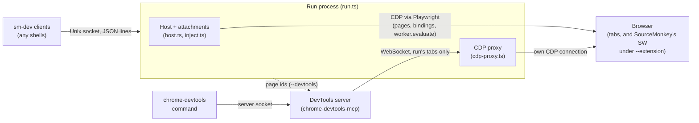

# sm-dev: design

`sm-dev` is the harness's interactive command-line tool. It builds on
the harness core described in [harness-design.md](harness-design.md);
the commands themselves are in [harness-guide.md](harness-guide.md).

## Overview

- A **run** is a background process that owns one browser connection,
  its tabs, and the loaded scripts. It never reads stdin.
- The `sm-dev` process is only ever a **client** of runs: it starts
  them, sends them commands over a local socket, and prints what comes
  back. Any number of clients can talk to one run.
- The run connects with Playwright's `connectOverCDP`, or launches a
  Chromium itself with `--temp-browser`.
- `--extension` has the real extension run the scripts: the run pushes
  them into it, claims its tabs, and fills its host from the extension's
  events. The commands, tabs and waits are the same for both. See
  [sm-dev-extension.md](sm-dev-extension.md).

### Processes and connections

- Pages talk back to the host through CDP bindings, one channel per
  world (see [harness-design.md](harness-design.md#a-channel-per-world)).
- The DevTools pieces exist only with `--devtools`.

### Modules

| Module | Role |
| --- | --- |
| `cli.ts` | The client: global options, sm-dev's own commands, the `Client` connection, starting runs |
| `run.ts` | The run process. Its own module so the Node-only commands never load Playwright |
| `runs.ts` | The registry of runs on this machine, and the client connection (`RunClient`). Node-only |
| `run-log.ts` | Each run's log file |
| `command-list.ts` | Every command's help, arguments and options, as data |
| `command-lines.ts` | Input lines into commands: blocks, lists, stdin |
| `checks.ts`, `path-args.ts` | `match` / `validate`, and file-argument globs |
| `console-commands.ts` | A run's commands across its tabs, the dialog tracker, the `--interactive` prompt |
| `page-commands.ts`, `snapshot.ts` | Commands that drive and read a page |
| `wait.ts` | `wait`, and when a tab has settled |
| `tab-refs.ts` | Naming and picking tabs (`T2`, target and DevTools page ids), the current tab, the dialog message |
| `tab-badge.ts` | The favicon badge on controlled tabs |
| `save-html.ts`, `saved-pages.ts` | Saving a page, and serving it back at its URL |
| `browser-launch.ts` | `--open-browser` |
| `browser-lang.ts` | `start --lang`: the languages the run's tabs prefer |
| `stuck-tabs.ts` | Waiting out unresponsive tabs before connecting |
| `cdp-proxy.ts`, `devtools.ts` | `--devtools` |
| `page-output.ts` | Which page console lines and errors the run streams |

## Runs and clients

### Starting a run

- `start` (in `cli.ts`) runs the same `start` command again as a
  detached child process, and waits for the child to be ready.
  - The child's stdout and stderr go to its log file. The parent prints
    the file as it grows, without the line timestamps, until the child
    is ready.
  - The child learns it is the run from `SM_DEV_DETACHED_LOG`.
  - It says it is ready over the Node IPC channel (`onReady`, called
    where sent commands start being taken). A child that exits first
    passes on its exit code.
  - A child whose parent has gone (a tool timeout) still becomes ready;
    with no channel to report on, it just runs on.
  - The parent handles Ctrl-C, SIGTERM and SIGHUP (sent when the
    terminal closes) while the child starts, by ending the child and
    exiting 130.
- The run's own process gets the browser's options again, as global
  options, on its command line.
- What a new run replaces is stopped before it starts, so its tab is
  free to reuse. (A new run that then fails leaves neither.)
  - The run the client works with, whose id the new one takes.
  - Else, with `--detach` and not `--new`, runs whose record is marked
    `detached`.

### The run registry (`runs.ts`)

Serves `sm-dev list`, `stop`, `attach` and the commands sent to a run.

#### Ids

- A run's id is the lowest free `D<n>`. It takes one by listening on
  its socket, which only one process can. The record is written after,
  so `list` never shows a run it can't reach yet.
- A socket file nothing listens on (a killed run's) is cleared and
  listened on under a `D<n>.clearing` lock directory, held until the
  listen. Otherwise a second run could delete the first's freshly bound
  socket.
- A lock already held means trying the next number, so one left by a
  killed run costs a number, never a hang.
- `--run Dname start` takes that id the same way, or fails if a run
  holds it; `cli.ts` stops that run first.

#### Records and sockets

- A run waiting for commands writes a record file (id, pid, start time,
  browser and whether it's owned or headless, scripts).
- It listens on a Unix socket (a named pipe on Windows).
- Both live in a per-user temp directory, `sm-dev-runs-<user>` (by user
  name, or uid where there is none). `SM_DEV_RUNS_DIR` moves it, for
  tests.
- Stale records:
  - A record is deleted when listed if its pid is gone, or its socket
    refuses connections (the pid may have been reused).
  - The run deletes its own on the way out.
  - The delete re-checks first, since a new run may have taken the id:
    the record only if it names the same pid, the socket only if
    nothing listens on it.
- Permissions: the directory is created `0700`. Before anything in it
  is trusted (records, sockets, tab records), it is refused if another
  user owns it or can write in it, since `stop` signals the pids its
  records name.

### The client (`Client` in `cli.ts`)

- Holds the connection to the one run it works with: `--run`'s, else
  the one it started or attached to, else the only one. Made when a
  command first needs it.
- `start` and `attach` switch it to another run; `stop` leaves it with
  none.
- Remembers the runs it started without `--detach`. `finish()` stops
  them: on `exit`, at the end of the line or input, or on a signal. A
  second signal exits at once.
- Whether it follows the run's whole stream is decided once, up front:
  when the line has a command that isn't only a look, or its input has
  no known end (`--stdin`, `--interactive`).
- The `--interactive` prompt and stdin reading both run in the client.
- sm-dev's own commands run there: `start`, `attach`, `stop`, `exit`,
  `list`, `clear`, `help`, and `match` / `validate` on files. The rest
  go to the run.

### The protocol

- One connection per client (`RunClient`), carrying JSON messages, one
  per line.
- An optional first `{"hello": {"follow": true}}` asks for the run's
  whole stream from then on. `Remote.follow` in `run.ts` adds the
  connection as a listener; no history is replayed.
- Commands are `{"line", "cwd", "words", "interactive"}`, taken one at
  a time.
  - Each reply ends with a `COMMAND_DONE` line (`\u0000sm-dev:done
    <code>`) carrying the command's exit code.
  - The line starts with a NUL, which no output line starts with.
    `RunClient` takes it off and returns the code.
  - `Remote.handle` returns an exit code, or `hold` for `stop`, which
    keeps the connection open until the run closes it, so the client
    sees the run end.
- `sendLine` is one command over a connection of its own.

### Running commands

- `Remote` feeds sent commands through one `commandRunner` queue, so
  they never interleave.
- Lines arriving before the page has loaded wait for it.
- Once the run starts tearing down, sent lines are refused.

#### When a command is done

The reply ends when the command does, with no wait after it. Commands
instead wait out what they set off that has a known end:

- Every page load a command or `--watch` save makes (`loadInTab`)
  waits for each script in the tab to report starting, being skipped,
  or throwing in the new document (`HarnessHost.untilReported`), or for
  a dialog.
  - Only reports stamped at or after the new document's start count, so
    late ones from the old document don't end it.
  - A hash-only change loads no document, and waits for nothing.
  - A 10-second backstop, counted from the load, covers a script that
    never reports. It is not how the end is found.
- `drain` (in `inject.ts`) then makes a round trip through each CDP
  session, after a `setTimeout(0)` in the page.
  - Needed because a script reports its start before its body runs,
    and a MAIN-world menu handler runs a task after its push.
  - Console lines come on Playwright's session and reports on the
    harness's, so each gets its own round trip.
  - Used after page loads, `menu` fires and `eval`.

#### Who sees the output

- Inspecting commands (`onlyInspects`: `status`, `values`, `snapshot`,
  `logs`, `tabs` / `menu` listings and so on) answer the sender alone.
  Their lines go through the `commandOutput` async-local store, so the
  run's stream never shows them.
- Commands that change things print to the run's stream. A sender not
  following it still gets what the page and scripts print during the
  command's turn.

### Idle timeout

- A run with a follower doesn't go idle.
- The idle timer restarts as each command starts and ends, and while
  any client follows (`onActivity(watched)`).
- Timed out, it stops the run as `stop` does.

### Stopping

- `stop` expects the run's `Stopping run D1` line first.
  - With it, it waits a minute for the teardown before `SIGTERM`.
  - Without it (no answer in 15 seconds, or a close without it), it
    signals at once.
  - Its connection is dropped either way, so `stop` itself never hangs.
- The run handles `SIGTERM` as `stop` (on Windows it kills outright,
  with no cleanup). The signal drops the handlers, so a second one
  during teardown kills the run.

### The log (`run-log.ts`)

Every run has one: its stdout and stderr.

- Named `sm-dev-<timestamp>.log` in `/tmp/sm-dev-logs-<user>`, with
  SeeWhatISee's timestamp format. `SM_DEV_LOGS_DIR` moves it, for
  tests.
- Created exclusively; a name already taken moves the timestamp on a
  millisecond.
- The run stamps each line it writes, by wrapping
  `process.stdout.write` and `process.stderr.write`.
- Kept after the run ends.
- Once the run has its id, `<id>.log` is pointed at it: a relative
  symlink, made under a temp name and renamed over the old one.

Command marks:

- `Remote` marks a sent command that changes something as
  `<who>:<how> > command` (see `commandMark`), for where it happened in
  the stream.
  - An `eval` block shows as `primary:arg > eval {{`, `... <code>`,
    `... }}`.
- Who: `primary` when the sender's pid (from its hello) is the one
  `start` passed the run in `SM_DEV_PRIMARY_PID`, else `remote`.
- How: the command's `source`, `arg`, `stdin` or `prompt`. A client
  heads its own echoes with the source alone (`stdin > `).
- The mark also goes to the other followers, but not back to the
  sender, which heads its own output.
- Commands that only look, and what they print (known by `inCommand`),
  are left out.

## Command input

### The command line (`cli.ts`)

- `--help` anywhere on the line is found first: the help for each
  command named, and nothing run or checked.
- The global options are taken off the front of the line first:
  `--run`, `--root`, `--local`, `--stdin`, `--interactive`, and the
  browser's `--browser`, `--open-browser`, `--profile`,
  `--temp-browser`, `--headed`.
  - One later on the line is refused, and said to go first.
  - `--browser`, which `start` and `clear` also take, is excepted.
- The rest of the line holds one or more commands, split on `--`.
  Stdin and prompt lines are split the same way, except an `eval`
  block, which stays one command.
- Every command is checked before any runs.
  - A lone `start` with no `--detach`, `--seconds`, `--stdin`,
    `--interactive`, or commands after it is refused, since its run
    would stop at once.
- A name that isn't an `sm-dev` command but is a run command goes to
  the run. So does one argument of several lines, as a list.

### Is SourceMonkey installed (`sourceMonkeyState`)

- The run's first line and `status` say `has SourceMonkey`,
  `SourceMonkey disabled` or `no extension`; `status` asks again each
  time.
- First `Extensions.getExtensions`, which lists unpacked extensions,
  enabled or not: how SourceMonkey is usually loaded.
- Otherwise (a Web Store install, or a Chrome without that call), a
  hidden target (not in the tab strip) is sent to the extension's
  `manifest.json`.
  - It loads only when the extension is installed and enabled, and runs
    none of the extension's code. So a disabled Web Store install reads
    as absent.
  - The target lasts only as long as the check's connection.
- It uses a WebSocket of its own to the browser, since Playwright's
  browser session can't send to the new target. About 30ms.
- A check that fails or takes over 3 seconds says nothing, and the
  socket is closed however it ends.

### A stale build (`stale-build.ts`)

- `scripts/build.mjs` writes `lib/build-info.json`: the checkout it
  built from, and when the build started.
- At startup, `cli.ts` warns on stderr when that checkout's `src/` has a
  file modified since.
  - Not in a detached run's own process.
  - Not with `SM_DEV_NO_STALE_WARNING` set, as the test suites set it:
    they compare sm-dev's output exactly.
- The fix it names depends on where this sm-dev runs:
  - In the checkout: `pnpm run build`.
  - In an installed copy (a userscript repo): `pnpm install` there,
    after `pnpm run build` in the checkout when its own `lib/` is
    stale too. `pnpm install` copies `lib/` without building it.
- No `build-info.json`, or no checkout at that path: no warning.

### Help and flags (`command-list.ts`)

- The help is data: sections of commands, each with its arguments and
  options, rendered and wrapped to fit.
  - `help <command>` picks one command out of it, with the options any
    section lists for it.
- The same list gives each command's syntax (`commandSyntax`), the
  names Tab completes, and which commands go to a run.
  - Its flags come from its options and usage lines (`cdp [tab] --file
    <path>`). One whose term names a value (`--out FILE`) takes one.
  - Its `syntax` says what its arguments are. See below.

### Reading a command's words (`command-args.ts`)

One parser, `parseCommandArgs`, for every command: sm-dev's own
(`start`, `stop`, ...) and a run's. It runs before a command does, and
sm-dev's up-front check runs it too.

- Words:
  - Typed lines are split as a shell would, except that a quote opening
    inside a word stays in it (`a[href="x"]`).
  - A command from sm-dev's command line passes the shell's own words
    instead, so its quoting holds.
- Flags:
  - `--name`, or `--name value` / `--name=value` for one that takes a
    value. Unknown flags, missing or empty values, values on flags that
    take none, and repeats are refused.
  - A quoted word is never a flag.
  - `--help` where a flag can go is a request for the command's help
    (`help` in the result). The prompt, stdin and the run show
    `help <command>`'s text for it.
  - The global options (`--run`, `--root`, `--local`, which can repeat,
    ...) go before any command, and `takeGlobalFlags` in `cli.ts` reads
    them.
- Arguments, by the command's syntax:
  - `none`, or `words` (at most `max`).
  - `selector`: the rest of the line as typed, less its flags, which
    can go anywhere (a selector never starts with `--`).
  - `text`: some words, then the rest of the line as typed. Flags go
    before it; its `--words` are its own. Unquoted as a whole unless
    it's JavaScript or JSON.
- Also declared: a leading tab (`tab`), a `{{` block (`block`), and
  flags that may end unquoted text, with a near miss there refused
  (`trailingFlags`, for `wait log`).
- A form named by a keyword has its own syntax (`wait log <text>`).
- Every command carries sm-dev's directory, for relative paths.

### Lines, blocks and lists (`command-lines.ts`)

Turns input lines into commands, for the prompt, piped input, and a
list sent in one go (`parseCommandList`).

- `eval ... {{`, `set <key> {{`, `type <selector> {{` or `cdp ... {{`
  opens a multi-line block and a line of just `}}` closes it.
  - The markers are doubled because a line of just `}` is common in
    JavaScript and JSON (the end of a function or object). A single
    `}` would end the block too early.
  - A `}}` followed by a space and more words is an error, not the
    block's line, so misplaced flags aren't silently typed or
    evaluated. `}});` and `}},` stay the block's.
- Outside a block, blank lines and `#` comments are skipped.
- A list is checked in full before any of it runs, so a `{{` after
  another command, or a block never closed, runs none of it.
- A list sent in one argument goes over the client's connection one
  command at a time, in order. A block's newlines survive the trip,
  since the message is JSON.

### Stdin

Commands from stdin (`--stdin`, or piped with no command) go through a
`CommandAssembler` as lines arrive:

- What arrives without a pause (a file, or a pipe's lines within 50ms
  of each other) is checked in full first, as a list is.
- Later lines, from a terminal or a slow writer, are sent as each
  command completes. A mistake then stops the rest.
- readline holds back a last line with no newline until the input
  ends, so a half-written line is never taken early.

### The prompt (`console-commands.ts`)

- `readPromptCommands` runs in the client, never in the run.
- Output is drawn around it.
- Each command says whether it was typed at a person's prompt
  (`interactive`). There, `menu <label>` answers at once, rather than
  waiting a moment for a script still registering, as it does for
  piped input.

### Exit codes

- 2 when it printed an `ERROR:` line (an invalid command), even if it
  also failed.
- Else what it returns (a number, or false for 1).
- A throw is 2 for an invalid command and 1 otherwise.
- A run that is ending answers 1.
- Any failure stops a line of several, such as an explicit `wait`
  that gave up, or a page command or `menu` that failed (no element,
  a timeout, an `eval` that threw). `runConsoleCommand` returns false
  for those, as `runPageCommand` does. An `ERROR:` line (a typing
  mistake) stops it too.
  - Except a `match` or `validate` miss (1), which is an answer.

### File arguments (`checks.ts`, `path-args.ts`)

- `match` and `validate` share `checks.ts` between the command line and
  a run, so both print the same lines. In a run they read its loaded
  scripts and tabs.
- `validate` gives each script one of three verdicts:
  - `ok`;
  - `INVALID`, with the message the viewer would show;
  - `UNCHECKED`: the syntax check couldn't decide (it fails open, see
    [parse-check.md](parse-check.md#failing-open)). The script still
    loads, as in the extension, so this doesn't fail the command,
    but it isn't reported as `ok` either.
- Under each script it prints every warning, valid or not, with the
  line it is about: the load-time notes the viewer's Log tab shows
  (`warningLines` in `prepare.ts`). `start` and `load` print the same
  lines, with an undecided syntax check as a `warn:` line.
- File arguments go through `expandPathArg`, for `start`, `match`,
  `validate`, `load`, `open` and `newtab`.
- Globs are expanded by `path-args.ts` rather than the shell, since
  stdin and prompt lines never see a shell.
  - Only words with `*` and no scheme are globs; `?` and `[` stay
    literal, since URLs use them.
  - A host-like word is a glob too (`localhost/*`). A URL containing
    `*` must include its scheme.
  - `globMistake` refuses a `**` that isn't a whole path part, or is
    the last one, before any file is read.
- Directory symlinks aren't followed by `**` or a directory search, so
  a link up the tree can't loop.
- A directory stands for its scripts. Expanding to nothing is a usage
  error.

## The browser

### Connecting

- A connected browser is attached with `noDefaults`, which keeps
  Playwright's test overrides off the developer's own profile:
  - downloads rerouted to a temp folder that is deleted on disconnect;
  - every tab reporting focus;
  - a forced light color scheme.
- A connected browser is headless when the user agent from Chrome's
  `Browser.getVersion` says `HeadlessChrome`.
- A launched Chromium (`--temp-browser`) gets a free debugging port
  too, so other tools can connect, and `list` shows where. (Playwright
  itself talks to it over a pipe, except with `--extension`; see
  below.)
- A hidden one is started with `--mute-audio`, so pages (e.g. video sites)
  play no sound; a `--headed` one keeps its sound.

### Languages (`--lang`, `browser-lang.ts`)

- Each tab the run sets up gets a CDP session of its own, left open,
  since an override lasts only while its session does. On it:
  - `Emulation.setUserAgentOverride` with an empty `userAgent` and the
    list as `acceptLanguage`: `navigator.language(s)` and the header.
    The empty agent keeps the browser's own, and its client hints
    (`navigator.userAgentData`), which a real agent without metadata
    would drop.
  - `Emulation.setLocaleOverride` with the first language, for `Intl`.
    Only one connection can hold it, so it goes last, and a refusal is
    said without failing the tab.
- The session reaches the tab's own frames only. Cross-site iframes
  and workers are targets of their own, and keep the browser's
  languages (the iframe's requests do carry the header).
  - Reaching them would take auto-attaching to child targets, beside
    Playwright's own auto-attach, which holds new targets until it
    resumes them. Not done.
- A headless launched browser also gets Chrome's `--lang` and
  `--accept-lang`, which reach what a tab's session doesn't (iframes,
  workers, a popup's first page). They don't change `Intl`.
  - In a `--headed` one they may not apply: on Linux, Chrome takes its
    language from `LANGUAGE`, and `--accept-lang` is a headless switch.
    Untested; the tab's session still applies.
- `GM_xmlhttpRequest` and `GM_download` go out from Node, which would
  send `Accept-Language: *`. The host adds the requesting page's
  instead, with or without `--lang`.
  - Built from its `navigator.languages` (`PageLink.languages`) with
    descending q-values (`acceptLanguageHeader`), as Chrome and the
    `--lang` override build it. Chromium's headless shell differs
    (no header by default), which is harmless.
  - Read once per document, from the scripts' world, with a 1s cap: a
    request never waits on a page held by a dialog, and the page's
    own code can't change the value.
  - A header the script sets wins.
  - Matches the extension, whose requests carry the browser's
    languages.
- Playwright's test runner gives the contexts it launches a locale of
  its own, which holds the override. So the spec checks a launched
  browser through the `sm-dev` command line.

### `--temp-browser` with `--extension` (`extension-launch.ts`)

- Launches Playwright's Chromium with `--load-extension` pointing at the
  package's `dist/` (Google Chrome ignores that flag).
  - Hidden runs use `--headless=new`, the only headless mode that loads
    extensions.
- A persistent context on a temp profile, deleted when the run ends.
  - Its Preferences grant "Allow User Scripts" and pin the extension to
    the toolbar before launch.
  - It has no Playwright `Browser`, so the run connects over CDP to its
    port, as to any browser. That client leaves dialogs open, so only
    the run answers them.
  - The port is Chrome's pick (`--remote-debugging-port=0`, read from
    the profile's `DevToolsActivePort`). One picked beforehand could be
    taken first, and the run would connect to whatever took it.
  - Playwright's own signal handlers are off, so on Ctrl-C or `stop` the
    run closes the browser itself and ends quietly.
- Two launches: a first one sets the extension's `firstRunComplete` and
  removes any default collections it started adding, so the run's own
  launch has none.
- Before the run opens its tab, a placeholder script is pushed and
  cleared. In a fresh profile, a tab opened before the first script
  install can't message the extension (see TODO.md).
  - The launch's first tab predates that, so it is replaced by a new
    blank tab, which the run takes as T1.

### `--open-browser` (`browser-launch.ts`)

A browser that outlives sm-dev, started before the line's commands.

- Spawned on its own (detached), not with Playwright's `launch`, which
  ties the browser to the Node process.
- Idempotent: a browser answering on the port is used as is.
- A profile per port, since Chrome locks a profile.
  - The lock is `SingletonLock`, a link to `host-pid`. A second browser
    on the same profile hands its window to the first and drops its
    own debugging port.
  - A lock whose process is alive is refused, naming that browser's
    port (from its command line, via `ps`).
- Google Chrome's usual install paths first, then Playwright's
  Chromium. `SM_DEV_BROWSER_BINARY` and `SM_DEV_BROWSER_ARGS`
  override, which the tests use for a headless Chromium.

### Tabs stuck at connect (`stuck-tabs.ts`)

Before `start` connects over CDP, finds tabs whose page doesn't answer,
and waits for them.

- Why: Playwright's connection isn't ready until it has set up every
  tab. A tab showing a dialog answers nothing, so the connection hangs
  until Playwright's 30-second timeout.
- No CDP call reports a dialog that opened before the connection, or
  answers one: `Page.enable` stalls too, and
  `Page.handleJavaScriptDialog` says none is showing.
- So each tab is sent `Runtime.evaluate('1')` on a side connection.
  - One quiet for 2 seconds is named: a dialog, or a busy page. (A page
    paused in the debugger still answers.)
  - The stuck tabs are asked again each second.
- The run handles SIGINT and SIGTERM only once it has connected. During
  the wait, a signal (a Ctrl-C at the client, passed on as `SIGTERM`)
  ends it at once, with nothing to clean up.

### Dialogs

- Playwright dismisses any dialog nobody listens for, in every tab it's
  attached to, the person's own included.
  - So `run.ts` gives every page of a connected browser a dialog
    listener that does nothing.
  - Also, when that dialog is gone before the dismiss lands, the error
    is unhandled, and ends the run.
- The run's own tabs get a `DialogTracker` (`console-commands.ts`),
  which keeps dialogs open for the person or a typed `accept` /
  `dismiss`. Otherwise a script's `prompt()` would be answered with
  Cancel.
- A page stopped on a dialog answers no CDP call until it is answered.
  - So `load` / `update` refuse while one is open.
  - `PageAttachment.dispose` gives up on the page after a second;
    detaching the session drops what it registered anyway.
- A command that opens a dialog would wait on it for good, and hold up
  the `accept` queued behind it.
  - So each page action races the tab's dialog tracker (`untilDialog`,
    as `menu` does), and returns once a dialog is up.
  - The settle wait's limit is kept in Node too, since a stopped page's
    own timer never fires.
- `closetab` closes with the page's `beforeunload` handlers run, as a
  person closing the tab would.
  - A page that asks first opens a `beforeunload` dialog, which the
    tracker reports like any other: `accept` leaves, `dismiss` stays.
  - Playwright doesn't wait for such a close, so `closetab` races the
    close against the tracker for 5 seconds, and names a tab that did
    neither.
  - A tab already on a dialog is left open and named, as `reload all`
    leaves it, while the others close.
  - `--force` closes without the handlers. It answers an open dialog
    first (a page stopped on one never finishes closing).

## Tabs

### Reusing a tab (`openRunTab`)

- The tabs runs opened are recorded in a file in the runs directory,
  with the owning pid.
- A later run can take over a finished run's selected tab.
- A tab carries no mark a page couldn't fake, hence the file.
- A taken tab's page still runs the earlier run's scripts. Its console
  lines and errors are dropped (`staleTabs`) until the run's first
  navigation there commits, or kept if the run opens no page there.
  - Not navigated away first: a run that fails before loading anything
    leaves the page as it was.

### Followed tabs (`FollowedTabs` in `run.ts`)

A tab the run's tab opens (link, `window.open`, `GM_openInTab`), and
any tab those open, gets its own attachment on the same host with all
loaded scripts.

- Found by Playwright's `popup` event, plus a hook on the attachment
  for `GM_openInTab`, whose tab has no opener.
- Tabs the person opens have no opener, so they are left alone.
- Playwright reports a tab only once its document has committed, so the
  scripts also run in that document (`runImmediately`). An earlier
  run-at than idle may run late there, and the run says so. (See
  [Platform behavior](harness-design.md#platform-behavior-the-design-relies-on).)
- Link and `window.open` tabs stay open when the run ends, as under the
  extension. `GM_openInTab` ones still close with the opener's
  attachment.
- Host output from a followed tab gets its `[T<n>]` prefix through
  `host.pageOf`, and a map of numbers that outlives the tab, so a late
  report (a request finishing) still names it.
- The close listener goes on before any await, so a tab that closes
  during setup is dropped, not listed forever.

It also holds the run's own tabs:

- T1 is the run's first tab. With `--notab` there is none at first, and
  the first tab `newTab` opens becomes T1.
- `newTab` opens a tab for `newtab` and `--all`, attached before its
  first page loads. It takes the tab's number before awaiting anything,
  so tabs opened together are numbered in call order.
- It hands the commands the list of open tabs.

### Sandboxed pages (`wireSandboxCheck` in `run.ts`)

A CSP `sandbox` header without `allow-scripts` turns off script in the
page's own world, and Chrome skips MAIN-world scripts there without a
word. The extension can only infer it after the fact (see
[matching.md](matching.md#scripts-that-never-start)); sm-dev sees the
response, so it says so directly.

- Watches each tab's main-frame navigation responses, in both backends,
  skipping redirects, whose headers don't apply to the page.
- Warns on each load of such a page that the run's MAIN-world scripts
  match, naming them. The check and the wording live in
  `src/missing-scripts.ts`, shared with the extension's Log hint.
- The harness's own CDP injection is blocked there too, so under sm-dev
  those scripts also time out without starting.

### Applying script changes

`load`, `update`, and a `--watch` save all go through
`FollowedTabs.apply`:

- All open tabs get the new set, in load order, so run order stays the
  same.
- Only the tabs a changed script affects are reloaded: it was running
  there (`host.isRunning`), or its new rules match the tab's URL.
  - They reload together.
  - One waiting on a dialog is skipped and named, since its reload
    would hang.
- Scripts before the first changed one stay attached, so a tab that
  isn't reloaded never loses them; the rest are re-added.
- The file watcher restarts on the new set, so a loaded script, or a
  new local `@require`, is watched too.
- These changes run one at a time through one `serial` queue in
  `runInHarness`, since each reads the script list, awaits, and
  replaces it.
- A tab still being set up is left out of `apply` until its setup has
  caught up with the latest set.
- `update` skips a script whose files' modification times haven't
  changed since it was read, so a touch still forces one.

### Tabs without scripts

- Tabs opened with `newtab --noscript` are attached and followed like
  any, but get no injection, no badge, and no part in `load` /
  `update`. Tabs they open inherit that.
- The harness's bridge is still attached to them, so a page could tell.
- `open` / `reload` `--noscript` / `--script` switch a tab's mode for
  good (`FollowedTabs.setNoScript`):
  - Its scripts come off or go back on (the current set), and so does
    its badge, whose page script is unregistered too (`hideBadge`).
  - Run in turn with `load` / `update` / `--watch` saves (the `serial`
    queue), since they change what a tab has too. Refused while the
    tab is still being set up.
  - The page showing keeps its scripts until the load that follows; if
    that load fails, they run on there.
  - A tab switched off counts as running no script, whatever the host
    last heard from it.

### Naming things (`console-commands.ts`, `tab-refs.ts`)

- Each kind of thing has its own style of name: scripts `1`, tabs `T1`,
  menu commands `M1`, with `T2.` in front to name one on another tab.
- A bare number only ever means a script. One given where a tab or menu
  command belongs gets a "Did you mean T2?" hint.
- A `T<n>.` split only happens before a number or `M<n>` (or, for
  `menu`, a label), so a file name like `t1.user.js` stays a script.
- Per-tab state (started or skipped, menu commands, errors) is the
  host's reports filtered by `pageOf`. A script counts as running on a
  tab when its last report there is a start rather than a skip.
- Menu commands fire by record (`fireMenuEntry`), not by id, since two
  tabs can register the same custom id.
- A script's default page (`defaultPageUrl` in `prepare.ts`) is the one
  `start` opens when given no URL; `open`, `newtab` and `--all` use the
  same one.

### The tab badge (`tab-badge.ts`)

The badge `sm-dev start` draws over each controlled tab's favicon.
Push backend only; under `--extension` the toolbar badge does this job.

What it shows:

- Count and color follow the extension's toolbar badge
  (`computeBadge`): the scripts matching the document's URL, plus any
  that started or failed there.
- Red for an error, orange while expected and started disagree, else
  green. No purple: the run reloads the tabs a change affects.
- Reports count for the document they arrived during. The attachment
  keeps recent documents by loader id, with the times each was showing,
  so one restored from the back/forward cache keeps its own.

Drawing it:

- Drawn in the isolated world, top frame only, on a canvas over the
  site's icon.
- The site's icon links get their `rel` renamed, since Chrome doesn't
  reliably pick the last of several icon links.
- A site changing its icon later is followed, including code that finds
  the badge's link as "the" icon and sets its `href`.
- Only `<head>` is watched, and only icon links are looked at.
- Same-origin icons load in the page. A cross-origin one would taint
  the canvas, so the page asks the run through a binding.
  - The run fetches it with the browser context's cookies and hands
    back a `data:` URL.
  - Images only, so the binding can't be used to read pages past
    `@connect`.
  - A small cache keeps successes only.

Going grey:

- The run pings every 2 seconds, through one pair of host listeners for
  all tabs. On dispose it greys the badge at once.
- After 6 seconds without a ping (a killed run), the page greys it
  itself.
  - A hidden tab's timers are slowed, so there it can take up to a
    minute.
  - A late timer in a showing tab (a dialog, a restore) restarts the
    wait instead of flashing grey.
- A tab taken over from an earlier run shares that run's isolated
  world, so the old badge code carries on with the new pings. An owner
  mark on the root element keeps a second copy from drawing.

Opt-in (`PageAttachment.showBadge`) and best effort, so specs using the
fixture see the site's own icon, and a failed badge doesn't fail a tab.

## Page commands

### Driving the page (`page-commands.ts`)

The run commands that drive and read a tab's page (`click`, `type`,
`key`, `eval`, `snapshot`, `screenshot`, `savehtml`, `probe`, `logs`,
`cdp`), on the run's own Playwright connection.

- Real input comes from Playwright's locators and keyboard; the
  accessibility tree from `ariaSnapshot`.
- An action whose element never passes Playwright's checks times out.
  The error names the last check its call log says failed (hidden,
  disabled, moving, covered by which element), not the general list.
- Actions then wait for the page to settle (see [Waiting](#waiting-waitts)):
  a navigation they started to reach its DOM, then a MutationObserver
  in the page quiet for 100ms, within 3 seconds.
- `eval` goes through the tab's own CDP session
  (`PageAttachment.evaluate`), in the page's default context or the
  isolated world the harness keeps for scripts. Results print as JSON,
  or as the DevTools console describes an element or function.
  - It evaluates as console input (CDP `replMode`: top-level `await`,
    `let` redeclarable). A top-level `return` is a syntax error there,
    so code that fails with that runs again wrapped in
    `(async () => { ... })()`. The syntax error means nothing ran.
- `cdp` opens a fresh CDP session on the tab (`newCDPSession`) for each
  command and detaches it after.
  - Settings the calls make (like `Emulation.*` overrides) end when
    the command does, and never reach the run's own session.
  - Being a run command, it needs no `targetId` or port: the run
    already has the tab.
  - A command makes one call. A `{{` block or `--file` makes several,
    one per line, so which calls share a session is always plain.
  - Typed calls are read from the raw text, not split into words,
    which would take the quotes out of their JSON.
- Every console line and page error is kept per page (the newest
  thousand) for `logs`, beside the filtered stream (`page-output.ts`).
- A console line that logs a DOM node is described from the page
  (`consoleText`: its opening tag), not Playwright's `JSHandle@node`.
  That takes a round trip, so the page's later console lines queue
  behind it to keep their order. A lookup that takes over a second (a
  dialog open, a paused page) prints Playwright's text instead.
- A console call's `%` directives are applied as the browser's console
  does (`formatConsoleArgs`): `%c` and its CSS drop out, `%s` and the
  like take the next value.
- A stream line over a thousand characters is cut, with its length;
  `logs` keeps it whole (`shortConsoleText`).
- Our own `sourcemonkey://` stack refs in stream lines are decoded once
  for display (`decodeOwnRefs`, sharing the viewer's `displayRefText`).
- Keys sent over CDP go to the renderer, so Chrome's own shortcuts
  never fire. The one that matters for scripts is Escape leaving
  fullscreen: after an Escape, `key` checks `fullscreenElement` and
  says how to exit when the page is still fullscreen.

### Snapshots and refs (`snapshot.ts`)

What `snapshot` adds to Playwright's tree.

#### Ref numbering

The tree is taken in Playwright's `ai` mode, where Playwright gives
each element a ref, `(f<n>)?e<n>`.

- `e<n>` counts elements within a document. An element keeps its ref in
  later snapshots unless its role or name changes.
- `f<n>` is the number of the document's frame on the run's connection;
  frame 0 goes without.
  - Each new document takes the next number: a reload, a navigation,
    each iframe, and other tabs too. So the numbers only go up, with
    gaps.
  - A page restored from the back/forward cache brings its old document
    back, and with it the old number.
  - The numbers start again with each `sm-dev start`.

#### Resolving refs

- A ref is looked up through the iframes the latest snapshot showed it
  in, each step `:root >> aria-ref=…`, never by its prefix.
  - Playwright finds a ref's frame by that number, and a page restored
    by Back keeps refs numbered for a frame Playwright has since
    renumbered ("Invalid frame in aria-ref selector").
- The whole page is `:root`, not `body`: scripts often add their panels
  to `<html>`, after `<body>`. Its `- document` line is left out, and
  the rest shown a level less indented.
- Playwright resolves refs against the latest snapshot only. So a
  snapshot of part of the page is followed by a quiet one of the whole,
  which keeps the rest's refs working.
  - That doubles the cost of `snapshot <selector>` on a large page. A
    failure only costs refs.
  - When the whole was `body`, refs from a part outside it (such as a
    panel) stopped working at once.
- Each page's latest snapshot is noted with its document's
  `performance.timeOrigin`, new with each load. A ref used after a load
  says so, not that no element has it, since Playwright's own record of
  the snapshot went with the old document.
- Each ref's line gives the label commands say back for it
  (`link "past"`), noted with the frames it's in.

#### Output

- `[cursor=pointer]` is dropped from links and buttons, which always
  have it.
- `--visible` takes the tree with boxes and keeps lines whose box meets
  the viewport, plus their parents. A frame's boxes are offset by the
  frame's, and clipped to it.

#### `probe --css` and `--html`

- Read a selector's first matches (their selectors and HTML) in one
  call to the page (`evaluateAll`).
- A ref's element takes `evaluate`, since Playwright finds it only in
  the world it took the snapshot in.
- It's for a few elements. `snapshot` had a `--css` that did every ref,
  one call each, which took seconds on a large page.
- Uniqueness is counted across open shadow roots too, as Playwright's
  CSS engine matches there.
- Elements in a frame get no selector, since the commands look for
  selectors in the page's own frame. Nor do elements in a shadow root,
  since a `>` path can't cross into one.

### Waiting (`wait.ts`)

The `wait` command, and when a tab has settled, for it and the waits
after `start`, loads and actions. The guide's
[Waiting](harness-guide.md#waiting) section lists the signals; here is
where each comes from.

- The quiet window counts from the later of the last change and when
  the wait began, so what an action sets off a moment later on a quiet
  page is waited for.
- **The DOM**: a `MutationObserver` the attachment adds to each
  top-frame document at its start, in the isolated world, recording
  when the DOM last changed and where. The favicon badge's own
  `data-sm-*` edits don't count.
- **The page's requests**: Playwright's request events, tracked per
  page by the attachment from the start, so a wait on a quiet page
  returns at once.
- **The scripts**: the host's start / skip / error reports since the
  document first started.
  - From the scripts it runs (`scriptsInDocument`: injected before it
    started, or into it directly) whose rules match its URL. One that
    doesn't match may never report, as on `about:blank`.
  - A document the back/forward cache restored doesn't run its scripts
    again, so its first start counts.
- **The scripts' `GM_xmlhttpRequest` records**, for the current
  document.
- A look into the page that takes over a second counts as busy (a long
  script). A dialog ends the wait, since the page stops on it.
- A tab whose load already gave up (`stalled`, set by `loadInTab`)
  isn't waited on again after it.
- A load (`loadPage`, for `open`, `reload` and the tabs `start` opens)
  ends at the page's `load` event, or when its `readyState` is
  `complete` without one: a page that calls `window.stop()` never
  fires `load`.

`wait log`:

- Reads the run's output history (`OutputHistory`, kept by `Remote` in
  `run.ts`, the last few thousand lines).
- Starts from where the previous command began (`previousStart`, kept
  by `commandRunner`, and not moved by a command that only looks or
  waits).
- Page console lines and errors the stream filters out
  (`page-output.ts`) go in too, through `Remote.hear`, in the form the
  stream would print them. So `wait log` sees what `logs` shows, except
  the prelude's `[SourceMonkey]` lines and page errors that repeat a
  host report.
- Only what the page and scripts printed goes in it. A command runs
  inside `inCommand` (an `AsyncLocalStorage`, Node's per-call context),
  and its own replies are kept out; page and script lines arrive
  through events outside it.

### Saved pages

#### Saving (`save-html.ts`)

- A page's DOM as a standalone file, for `savehtml` and the fixture's
  `saveHtml`, with a header of where it came from, and the reader for
  that header.
- The URL goes in the "saved from" comment of Internet Explorer's Mark
  of the Web, which Chrome's Save Page As still writes, so either kind
  of file reads the same.

#### Serving (`saved-pages.ts`)

Serving a saved file back at its URL, for `--from-saved` and the
fixture's `serveHtml`.

- `pagesToOpen` sorts a command's pages for `start`, `open` and
  `newtab` alike. With `--from-saved`, the local `.html` files become
  saved pages and the rest stay URLs, and every file is checked before
  any tab opens.
- Served with a `page.route` on the real URL, not as a `file://` page,
  so matching, origin, cookies and relative URLs are the site's. The
  same holds under `--extension`, whose own injection only sees the
  URL.
- A `<name>_files` folder beside the file (a browser's "Webpage,
  Complete" save) is served from disk. The page links it relatively, so
  requests under that path on the page's URL map into the folder, and
  never outside it.
- A site's service worker would answer before the route, so the page's
  network domain is told to bypass it (best effort).
- The route is added once per tab and reads the tab's `saved` per
  request, so replacing it needs no new route, and each load reads the
  file fresh.
- The route and the service-worker bypass stay for the tab's life, so
  live pages in that tab load a little differently:
  - While a tab has any route, Playwright intercepts all its requests,
    and Chromium skips its HTTP cache.
  - The bypass makes later live pages skip their service workers too.
  - Accepted, since the guide already sends the live page to another
    tab.

## DevTools

`start --devtools` gives the `chrome-devtools` command access to the
run's tabs. It is the command-line client of Chrome DevTools MCP, a
DevTools server for agents (MCP: Model Context Protocol, the protocol
agent tools speak).

### The CDP proxy (`cdp-proxy.ts`)

A CDP endpoint that shows a client only the run's tabs, for the
DevTools server to connect to.

- Why: DevTools' Puppeteer attaches to every tab in the browser, and
  its connection isn't ready until each has reported the page inside
  it. One of the person's tabs that never answers (seen with frozen
  background tabs, and tabs on a dialog) stalls every DevTools call.
- Each client gets its own connection to the browser. Traffic passes
  through, except:
  - events about other tabs, which are dropped;
  - `Target.getTargets`, which is filtered;
  - tabs the browser attaches to that connection anyway, which are let
    run (if paused) and detached.
- Workers, service workers (extensions' included) and the browser
  target are hidden too. The client still reaches a page's own frames
  and workers through the page's session.
- Attaches the client asks for itself (Puppeteer's extra session per
  page) pass through, with their sessions.

Finding the run's tabs:

- A tab is shown when the page inside it is one the run allowed.
- Chrome lists a tab and its page under unrelated ids, and doesn't keep
  a tab's own URL up to date as its page navigates. So the page is
  found on a side connection: attach to the tab, let it report its
  page, detach (3 seconds).
  - Tabs are asked when a page is allowed whose tab isn't known yet, a
    few at a time, each once.
  - A tab that doesn't answer (a frozen one) is asked again only while
    an allowed page's tab is unknown.
  - Asking is done by the proxy alone; the client never sees those
    tabs.
- Knowing the run's tabs before the client connects keeps them in the
  client's initial attach, which Puppeteer waits for, rather than
  arriving after it.
- A tab not allowed yet is held for 30 seconds, not dropped, since the
  run only claims a tab its page opened once it's loading.
  - One claimed after it was let go is attached again.
  - Tabs the client opens itself (`new_page`) are allowed at once.
  - A held tab runs meanwhile: a person's new tab can't sit paused
    waiting for a claim. So a tab claimed later loses its
    pause-on-start, and the client may miss the start of its first
    load.

Transport: the client side is a small WebSocket server of its own
(handshake and text frames), since the harness has no WebSocket
library. The browser side uses Node's WebSocket client.

### The DevTools server (`devtools.ts`)

- The server connects through `cdp-proxy.ts`, not to the browser.
- Started with the `chrome-devtools` command, under the run's id as its
  session, so an agent's own calls reach the same server.
- Started with Google's usage statistics, CrUX lookups (Chrome's
  field-performance API) and update checks turned off.
- Off by default: DevTools emulates focus in the pages it sees (the
  run's), and `evaluate_script` answers dialogs.
- Not on Windows: the server's files and signals are only followed as
  they are on Linux and macOS.

Calling it:

- Called over the server's socket directly: a JSON request and reply,
  each ended by a NUL, as the command itself does.
  - A command per call would cost a Node startup each time.
  - The protocol is the package's own (followed as of 1.10), not a
    documented one.
  - Calling over the socket also never starts a new server, where the
    command would start one with its own Chrome if the run's had died.
- Each call gets 5 seconds, the first 15, since that is when the server
  connects to the browser.
- DevTools runs one call at a time, so one of the run's tabs not
  answering holds up everything. The run says so once, naming both
  causes, since a slow connect looks the same.

Mapping tabs to page ids:

- DevTools gives no id sm-dev can match to its tabs. Its page ids are a
  counter in the server, in the order it first sees pages, and its
  `list_pages` has only id, URL and title.
- So each unmapped tab gets a marker in its page's main world (the only
  world `evaluate_script` reads), the pages with a matching URL are
  read for it, and the markers are deleted.
- The marker is `<run>:<random token>:<tab number>`, so a leftover from
  another run or pass never matches.
- Mapping runs a moment after tabs open (batched), and again every two
  seconds while tabs are left unmapped (loading, on a dialog, a stuck
  call), a few times per tab.
- A tab out of tries is named; its next page load gives it its tries
  again.

Shutting down:

- On the way out it is stopped before the tabs are let go, so a lookup
  in flight has its calls cut off and can still delete its markers.
- The server is then killed (`SIGTERM`), not asked to stop, which would
  mean waiting behind a stuck call. It cleans up its own socket and pid
  file on `SIGTERM`.
- The pid is the one the server reports over its socket (`status`), not
  its pid file's: a server that died uncleanly leaves a file whose pid
  may be another process's by now.
