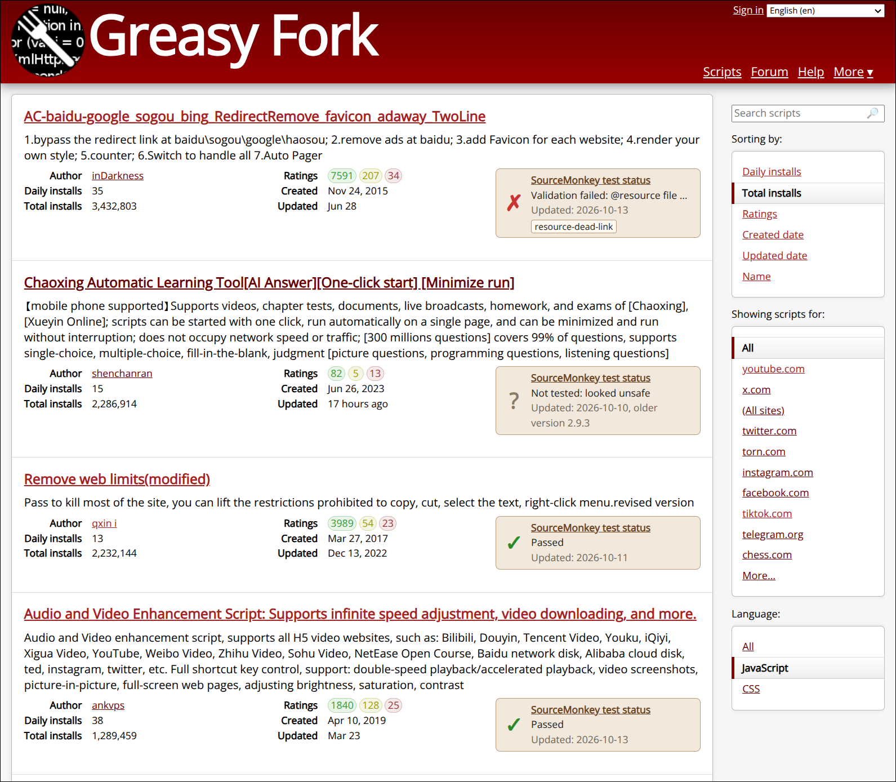

#  Show SourceMonkey test status on Greasy Fork

## Summary

SourceMonkey includes tools that can test userscripts automatically, using
the SourceMonkey extension and coding agents.
We've tested Greasy Fork's 2000 most-installed scripts, and some
popular scripts in other categories, and stored the results.

This userscript adds status boxes showing the test results directly on Greasy
Fork, answering **Does this script actually work?**

For scripts that have been tested, the status box shows:

- Test result:
  - ✓ *Passed*: the script works
  - ✗ *Failed*, with the reason
  - ? *Not tested* or *Inconclusive*, with the reason
- The date tested, and the version.
- A link to the
  [test results page](https://jshute96.github.io/SourceMonkey/greasyfork-testing/results.html),
  with more detail for that script.

Tests include:

- Is the script valid? (Valid headers and code, loadable resource files, etc.)
- Does the site still exist?
- Does the script still work against the current site?
- Does it do what it appears intended to do?

Some scripts weren't tested, mainly because they require an account, are for
paid sites, are games that need interactive play, or seemed unsafe to
test. An inconclusive result means the script couldn't be verified either way,
e.g. because the target condition didn't occur while testing.

By default, test results are loaded from a status file published through
GitHub. The script's menu has an option to switch to a locally served test
results file, as described
[here](https://github.com/jshute96/SourceMonkey/blob/main/greasyfork-testing/README.md#published-or-local-results).

**Example:**

## Visible changes

- On script pages and listings, a panel beside the stats block of each
  script with test results, linking to it on the results page
  (`results.html`).
- When the results can't be loaded, one panel on the first script says
  why. For the local source, it also names the command that starts the
  server.
- Two menu items, "Published results (GitHub Pages)" and "Local results
  (localhost:8765)", with the one in use checked. Choosing the other
  reloads the page.

## Implementation

### Where the panels go

Greasy Fork renders its pages on the server, so the script does its work
once per page load.

- **Listings** (search, user pages): each script is an
  `li[data-script-id]`, with `data-script-version`, holding a
  `.script-meta-block` of stats.
- **Script pages**: `#script-stats`, whose parent is the
  `.script-meta-block`. The ID comes from `/scripts/<id>` in the path, the
  version from `dd.script-show-version`.
- The panel is placed by wrapping the meta block and the panel in a new
  flex row (`.smts-row`). It wraps under the stats below 800px.

### The data

Both files are read with `GM_xmlhttpRequest` from the chosen source
(`https://jshute96.github.io/SourceMonkey/greasyfork-testing/` or
`http://localhost:8765/`):

- `corpus.json`: the corpus. `summarize()` keeps only the fields the panel
  uses, per script, under short keys (listed in the code).
- `corpus-help.js`: the hover text. It's a script assigning one strict-JSON
  object (`var CORPUS_HELP = {...}`), so the object is cut out and parsed
  with `JSON.parse`, not run. Without it, the panel just has no hovers.
- Hand-added tags' descriptions come from the corpus's `tags`; built-in
  tags' from `corpus-help.js`.

### Caching

Each file is stored in GM storage per source (`corpus:published`,
`help:local`, ...) with the file's `Last-Modified` date.

- On each page load, a `HEAD` request checks the date. Only a changed file
  is downloaded and rebuilt.
- If the server can't be reached or returns an error, the stored copy is
  used.
- A file with no `Last-Modified` isn't stored, so it's fetched every time.
- `CACHE_FORMAT` is stored with each copy. Bump it after changing what
  `summarize()` keeps, so old copies are rebuilt.
- The `source` value holds the menu choice.

### Tests

`show-test-results.spec.ts` runs the script on saved Greasy Fork pages in
`test-pages/` (a script page and a user's listing, trimmed), with a small
made-up corpus answered from the spec, so it needs no live service.

### What we assume stays stable

- `li[data-script-id]` and `data-script-version` on listing rows.
- `.script-meta-block` around the stats, and `#script-stats` and
  `dd.script-show-version` on script pages.
- The `/scripts/<id>` path prefix of script pages (after an optional
  locale).
